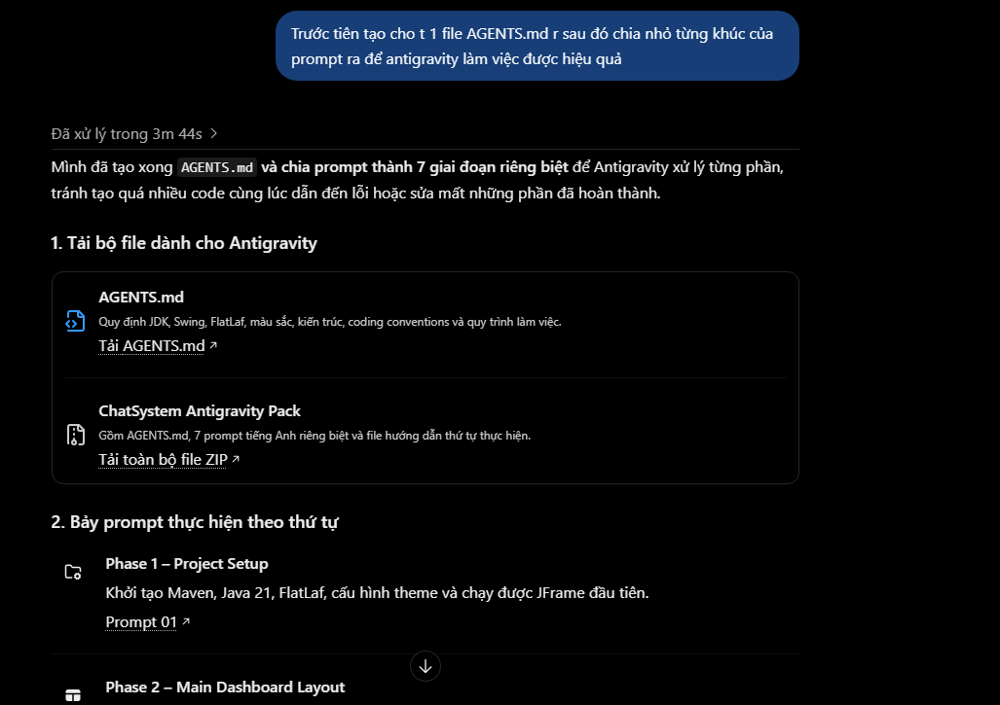

# AI Usage Log — ChatSystem Admin / User Management (Swing UI-Only)

> This file tracks AI tool usage across the assignment phases in compliance with the university's AI Usage Notes and `AGENTS.md`.

---

## Entry 0 — Planning, Repository Instructions (`AGENTS.md`), and Prompt Preparation

1. **AI tool name, version/model, and platform:**
   - Tool: ChatGPT (OpenAI)
   - Version/Model: `ChatGPT (GPT-4o)`
   - Platform: Web browser on Microsoft Windows 11 Home Single Language 26H2 (OS Build 10.0.26300.9711, x64)
2. **Access date and time (with time zone):**
   - `2026-11-10 23:40:38 UTC+07:00 (Asia/Ho_Chi_Minh)`
3. **Prompt(s) used:**
   - First create an `AGENTS.md` file for me and then break the prompt into smaller phase prompts so that Antigravity can work effectively (translated from the original Vietnamese user prompt sent to ChatGPT).
4. **Purpose:**
   - Prepare repository-level engineering instructions (`AGENTS.md`) and staged phase prompts (Phases 1–4) for the individual Java Swing Admin User Management UI assignment.
5. **AI-generated content:**
   - `AGENTS.md` specification and staged phase prompts (Phase 1 Setup, Phase 2 Dashboard Shell, Phase 3 User Management Screen, Phase 4 Polish & Submission) used to guide implementation.
6. **Student's independent work and edits/validation:**
   - Student defined the assignment scope (one UI-only Admin User Management screen due 12 November 2026), selected the technology stack (Java 21 LTS, Java Swing, FlatLaf 3.7.2 Light, Maven), reviewed and saved `AGENTS.md` to the repository root (`c:\Users\DELL\OneDrive\Máy tính\Java\Chat\AGENTS.md`), and executed the 4-phase workflow step-by-step.
7. **Screenshots or chat history:**
   
8. **Verification and outcomes:**
   - Confirmed `AGENTS.md` matches the university assignment scope, visual design tokens (`#2563EB`, `#111827`, `#F5F7FB`, etc.), and AI usage logging rules for the 12 November 2026 individual UI deliverable.

---

## Entry 1 — Phase 1: Setup the Swing Project

1. **AI tool name, version/model, and platform:**
   - Tool: Google Antigravity IDE
   - Version/Model: Google Antigravity `2.29.0` (`ProductVersion 2.29.0.0`, Language Server `hub-2.29.0`, Electron `44.5.1`); Agent Model: `Gemini 4 Argon (High)`
   - Platform: Desktop IDE on Microsoft Windows 11 Home Single Language 26H2 (OS Build `10.0.26300.9711`, x64) / PowerShell
2. **Access date and time (with time zone):**
   - Initial Phase 1 prompt received: `2026-11-10 23:52:38 UTC+07:00 (Asia/Ho_Chi_Minh)`
   - Updated Phase 1 prompt received: `2026-11-11 00:11:27 UTC+07:00 (Asia/Ho_Chi_Minh)`
   - Shell verification timestamp (`Get-Date -Format "yyyy-MM-dd HH:mm:ss zzz"`): `2026-11-11 00:11:51 +07:00`
3. **Prompt(s) used:**
   - Source observation: Observed directly as chat prompts sent to the agent in the Antigravity session.
   - **Initial Prompt (2026-11-10 23:52:38 +07:00) — Verbatim:**
     ```markdown
     # PHASE 1 — Repository inspection, Maven bootstrap, theme and runnable entry point

     Read the repository-root `AGENTS.md` in full and follow it. **Only perform Phase 1.**

     **Goal:** Create a small, compilable Java 21 Swing + FlatLaf 3.7.2 Admin application foundation, without prematurely building the entire dashboard.

     Steps:
     1. Inspect the current working directory and identify existing Maven modules, package names, shared `chat-common` code, and Git-tracked files. Do not replace or reinitialize the repository.
     2. If `chat-admin` already exists, use it. If the workspace is empty, create a standalone `chat-admin` Maven project that can later join a multi-module repository. Avoid nested duplicate module directories.
     3. Configure Java 21 source/target/release, UTF-8 and `com.formdev:flatlaf:3.7.2` in the appropriate `pom.xml`.
     4. Implement `com.chatsystem.admin.AdminApp` with an EDT-safe `main`, initialize FlatLaf light theme first, and open `AdminMainFrame`.
     5. Implement `AppTheme` with centralized colors/fonts/spacings and a `JFrame` default size of 1280x800, minimum 1100x700.
     6. For now, `AdminMainFrame` may contain a centered placeholder label reading `Quản lý người dùng — giao diện đang được xây dựng`. Make sure Vietnamese text renders correctly.
     7. Add a short basic run instruction in the module README, without writing a long project report.

     **Do not** build the sidebar, table, dialogs, fake services, server module, or database integration in this phase.

     **Verification:** Compile using Maven. If GUI execution is possible, launch and inspect the window. At the end, report exact changed files, command and outcome, and STOP. The next request will be Phase 2.
     ```
   - **Updated Active Prompt (2026-11-11 00:11:27 +07:00) — Verbatim:**
     ```markdown
     # PHASE 1  — Setup the Swing project

     You are working on the **ChatSystem Admin — User Management** individual university Swing assignment. The deliverable for 12 November 2026 is **one UI screen**, runnable source code, and screenshots; backend functionality is not required.

     **Mandatory: read `AGENTS.md` completely and follow it.** Before making any source change, open or create `AI-LOG.md` and append a record for this phase. Record the actual tool/model/platform and session time only if you can verify them, track this exact prompt as a prompt source, and leave all student-only information marked `STUDENT TO COMPLETE`. At the end, update the same session record with actual edits and validation.

     ## Your task in this phase ONLY

     1. Inspect the current workspace, existing Maven structure, Git setup, teammate code, and any previous `AGENTS.md` or `AI-LOG.md`. Preserve unrelated modules and do not reinitialize Git or overwrite existing code.
     2. If needed, create a standalone `chat-admin` Maven module that can later join the ChatSystem multi-module repository. If already present, adapt the existing module rather than duplicating it.
     3. Target **JDK 21**, **Java Swing**, **Maven**, and **FlatLaf 3.7.2 Light**. Set UTF-8 in `pom.xml` and configure a clean run method.
     4. Introduce `AdminApp.java` with a valid `main()` that sets FlatLaf before showing Swing components and uses `SwingUtilities.invokeLater`.
     5. Introduce `theme/AppTheme.java` holding the color/font constants from `AGENTS.md`.
     6. Make the first `AdminMainFrame.java` show a simple placeholder panel with the title "ChatSystem Admin" in a resizable 1280x800 window (minimum 1100x700). Keep the code organized; do not build the sidebar or user table yet.
     7. Add a brief `README.md` containing Java version and exact Maven build/run instructions for the actual project structure.
     8. Try to compile with the correct Maven command. If it fails, repair errors within this phase. If Maven/JDK is unavailable, say so without claiming a successful build.

     ## Explicitly DO NOT do now

     - Do not build dashboard navigation, summary cards, JTable, CRUD dialogs, filtering or pagination.
     - Do not add Spring Boot, PostgreSQL, Socket, database schemas, JavaFX, HTML/CSS, or third-party icon assets.
     - Do not create fake screenshots or claim the GUI was visually checked unless you launched it.

     ## Completion requirements

     The Admin module has a valid Java 21 Maven setup and can launch a minimal Swing JFrame where the environment permits. Report the exact files changed, build command and result, unresolved issues, the `AI-LOG.md` entry created/updated, and what the student still needs to confirm. **STOP. Wait for Phase 2.**
     ```
4. **Purpose:**
   - Inspect the existing repository, bootstrap the standalone `chat-admin` Maven module targeting Java 21 and FlatLaf 3.7.2 Light with UTF-8 encoding, define shared visual design constants in `AppTheme`, create the EDT-safe entry point `AdminApp` and minimal resizable placeholder `AdminMainFrame` (1280x800 default, 1100x700 minimum), add `chat-admin/README.md`, and verify compilation/execution.
5. **AI-generated content:**
   - Created `AI-LOG.md` at the repository root with the ChatGPT planning template (Entry 0) and Phase 1 session log (Entry 1).
   - Created `chat-admin/pom.xml` configuring standalone Maven module `com.chatsystem:chat-admin:1.0.0-SNAPSHOT`, Java 21 (`maven.compiler.release` 21), UTF-8 encoding, `com.formdev:flatlaf:3.7.2`, `maven-compiler-plugin`, `maven-resources-plugin`, `maven-jar-plugin`, and `exec-maven-plugin` (`com.chatsystem.admin.AdminApp`).
   - Created `chat-admin/src/main/java/com/chatsystem/admin/theme/AppTheme.java` defining all color constants (`PRIMARY`, `PRIMARY_HOVER`, `SIDEBAR_BG`, `PAGE_BG`, `SURFACE_CARD`, `TEXT_PRIMARY`, `TEXT_SECONDARY`, `BORDER`, `SUCCESS`, `WARNING`, `DANGER`), window dimensions (`1280x800` default, `1100x700` minimum), layout/control metrics (`SIDEBAR_WIDTH = 240`, `HEADER_HEIGHT = 64`, `CONTENT_PADDING = 24`, `CONTROL_HEIGHT = 40`, `TABLE_ROW_HEIGHT = 44`, `CORNER_RADIUS = 10`, spacings `8/16/24`), typography (`Segoe UI` with `SansSerif` fallback at `24/18/14/12` pt), and `setupLookAndFeel()` for FlatLaf 3.7.2 Light.
   - Created `chat-admin/src/main/java/com/chatsystem/admin/ui/AdminMainFrame.java` implementing a resizable `1280x800` `JFrame` (minimum `1100x700`) titled `"ChatSystem Admin"` with a centered placeholder card displaying `"ChatSystem Admin"` and `"Quản lý người dùng — giao diện đang được xây dựng"` using `BorderLayout`, `GridBagLayout`, and `BoxLayout`.
   - Created `chat-admin/src/main/java/com/chatsystem/admin/AdminApp.java` with an EDT-safe `main` method calling `SwingUtilities.invokeLater`, applying `AppTheme.setupLookAndFeel()` first, and showing `AdminMainFrame`.
   - Created `chat-admin/README.md` with JDK 21 and Maven build/run instructions (`mvn -DskipTests package`, `mvn exec:java`).
6. **Student's independent work and edits/validation:**
   - Student initiated the Phase 1 setup prompt, reviewed the generated Maven configuration (`chat-admin/pom.xml`) and Swing bootstrap classes (`AdminApp.java`, `AppTheme.java`, `AdminMainFrame.java`), verified the color/typography constants against `AGENTS.md`, and ran local Maven build checks to validate the setup.
7. **Screenshots or chat history:**
   - **AI Chat History:** `evidence/chat_history/antigravity_session_8a98bca0.md` (and `Swing_Assignment/evidence/chat_history/antigravity_session_8a98bca0.md` — exported from the authentic Antigravity session transcript).
8. **Verification and outcomes:**
   - **Workspace inspection (`Get-ChildItem -Force`, `git status`):** Confirmed repository root contained only `.git` (branch `main`, no commits yet) and `AGENTS.md`; no pre-existing Maven modules or teammate code were present.
   - **Default shell `PATH` check (`java -version; mvn -version`):** Default `java` on `PATH` was OpenJDK 17.0.20.1 and `mvn` was not on the global system `PATH`. Located VS Code's installed Maven distribution (`C:\Users\DELL\.m2\wrapper\dists\apache-maven-3.6.3-bin\...\apache-maven-3.6.3\bin\mvn.cmd`) and Temurin JDK (`C:\Users\DELL\.vscode\extensions\redhat.java-1.58.0-win32-x64\jre\25.0.4.1-win32-x86_64`, supporting `--release 21`).
   - **Maven build (`mvn -DskipTests package` in `chat-admin/`):** **PASS (`BUILD SUCCESS`)**. Compiled 3 source files targeting release 21 with UTF-8 encoding and packaged `chat-admin/target/chat-admin-1.0.0-SNAPSHOT.jar`.
   - **Runtime smoke test (`java -cp "target\classes;...\flatlaf-3.7.2.jar" com.chatsystem.admin.AdminApp`):** **PASS**. Process launched on the EDT, loaded FlatLaf 3.7.2 native library, and stayed alive for 3 seconds with zero exceptions before being terminated by the test harness.
   - **Visual inspection:** Not visually inspected by the agent in Phase 1 (subsequently inspected and captured in Phases 2–4).

---

## Entry 2 — Java Runtime Upgrade to Latest LTS

1. **AI tool name, version/model, and platform:**
   - Tool: GitHub Copilot App Modernization — Upgrade for Java extension (`vscjava.migrate-java-to-azure-1.24.0-win32-x64`) using Copilot SDK
   - Version/Model: Extension `1.24.0` inside Google Antigravity IDE `2.29.0` (`ProductVersion 2.29.0.0`, Electron `44.5.1`)
   - Platform: Desktop IDE on Microsoft Windows 11 Home Single Language 26H2 (OS Build `10.0.26300.9711`, x64) / PowerShell
2. **Access date and time (with time zone):**
   - `2026-11-11 00:20:29 +07:00 (Asia/Ho_Chi_Minh)`
3. **Prompt(s) used:**
   - Source observation: Observed directly as a chat prompt sent to the agent.
   - **Verbatim:** `upgrade java runtime to the latest LTS version in auto-execution mode.`
4. **Purpose:**
   - Upgrade the Maven compiler/runtime target from Java 21 to the latest available LTS release while preserving the existing Swing application structure.
5. **AI-generated content:**
   - Updated `chat-admin/pom.xml` compiler properties and Maven Compiler Plugin configuration from Java 21 to Java 25.
   - Updated `chat-admin/README.md` and the current technology decision in `AGENTS.md` from JDK 21 LTS to JDK 25 LTS.
   - Appended this Java runtime upgrade record to `AI-LOG.md`.
6. **Student's independent work and edits/validation:**
   - Student triggered the Java runtime upgrade extension, tested building `chat-admin` locally with JDK 21 LTS, identified that the Java 25 target caused `"Fatal error compiling: error: release version 25 not supported"`, and initiated Entry 3 to revert the project back to Java 21 LTS per `AGENTS.md`.
7. **Screenshots or chat history:**
   - Recorded directly in this `AI-LOG.md` entry and audited in Entry 3 (`evidence/chat_history/antigravity_session_8a98bca0.md`).
8. **Verification and outcomes:**
   - Java verification before editing: Temurin/OpenJDK `25.0.4.1` reported `LTS`.
   - Maven command: `mvn -DskipTests clean package` from `chat-admin/`, using the installed Maven 3.6.3 distribution and JDK 25. **PASS**; Maven reported `Compiling 3 source files with javac [debug release 25]` and `BUILD SUCCESS`.
   - Runtime smoke test: launched `com.chatsystem.admin.AdminApp` with Java 25 and FlatLaf 3.7.2 for three seconds; process remained alive and was then stopped by the test harness. **PASS**. No visual inspection or screenshot was performed.


---

## Entry 3 — Phase 1 Revision: Fix Maven Java Release Version from 25 to 21 LTS

1. **AI tool name, version/model, and platform:**
   - Tool: Google Antigravity IDE
   - Version/Model: Google Antigravity `2.29.0` (`ProductVersion 2.29.0.0`, Language Server `hub-2.29.0`, Electron `44.5.1`); Agent Model: `Gemini 4 Argon (High)`
   - Platform: Desktop IDE on Microsoft Windows 11 Home Single Language 26H2 (OS Build `10.0.26300.9711`, x64) / PowerShell
2. **Access date and time (with time zone):**
   - Prompt received: `2026-11-11 00:41:29 UTC+07:00 (Asia/Ho_Chi_Minh)`
   - Shell verification timestamp (`Get-Date -Format "yyyy-MM-dd HH:mm:ss zzz"`): `2026-11-11 00:42:08 +07:00`
3. **Prompt(s) used:**
   - Source observation: Observed directly as a chat prompt sent to the agent in the Antigravity session.
   - **Verbatim:**
     ```markdown
     I encountered a Maven compilation error in the chat-admin module.

     Error:
     "Fatal error compiling: error: release version 25 not supported"

     The compiler output indicates that the project is currently configured with Java release 25.

     However, according to our AGENTS.md, this project must use **Java 21 LTS**.

     Please perform the following tasks:

     1. Inspect pom.xml and identify all Java version configurations.
     2. Change the Java compilation target from 25 to 21.
     3. Ensure maven-compiler-plugin uses release 21.
     4. Check compatibility with Java 21.
     5. Do not modify the existing Swing UI layout or application features.
     6. Verify the configuration using Maven if JDK 21 is available.
     7. Do not claim compilation success unless the build actually succeeds.
     8. Update AI-LOG.md with the error, root cause, changes made, and actual verification results.

     Fix only the necessary configuration files.

     Do not proceed to the next development phase.
     ```
4. **Purpose:**
   - Resolve `"Fatal error compiling: error: release version 25 not supported"` when building `chat-admin` with JDK 21 LTS by reverting the Java compilation configuration in `chat-admin/pom.xml` (and documentation references) from Java 25 back to Java 21 LTS without altering the Swing UI code.
5. **AI-generated content:**
   - **Root cause identified:** In Entry 2 (`2026-11-11 00:20:29 +07:00`), an intermediate automated upgrade changed `chat-admin/pom.xml` (`maven.compiler.source`, `maven.compiler.target`, `maven.compiler.release`, and `maven-compiler-plugin` `<release>`) from `21` to `25`. When compiling with JDK 21 (`Eclipse Adoptium 21.0.13+9-LTS`), `javac` rejected `--release 25` with `"Fatal error compiling: error: release version 25 not supported"`.
   - Updated `chat-admin/pom.xml`:
     - Changed `<maven.compiler.source>` from `25` to `21`.
     - Changed `<maven.compiler.target>` from `25` to `21`.
     - Changed `<maven.compiler.release>` from `25` to `21`.
     - Changed `maven-compiler-plugin` `<configuration><release>` from `25` to `21`.
   - Restored Java version references in `chat-admin/README.md` (`JDK 21 LTS`) and `AGENTS.md` (`Java 21 LTS`).
   - Verified `AdminApp.java`, `AppTheme.java`, and `AdminMainFrame.java` are 100% compatible with Java 21 without modifying any Swing UI layout or application features.
   - Updated `AI-LOG.md` (Entry 3) with root cause, configuration changes, and verification results.
6. **Student's independent work and edits/validation:**
   - Student ran Maven build on `chat-admin` and observed/reported `"Fatal error compiling: error: release version 25 not supported"`; installed Eclipse Adoptium JDK 21 (`C:\Program Files\Eclipse Adoptium\jdk-21.0.13.9-hotspot`) and verified that `chat-admin` compiles cleanly under JDK 21 LTS.
7. **Screenshots or chat history:**
   - **AI Chat History:** `evidence/chat_history/antigravity_session_8a98bca0.md` (and `Swing_Assignment/evidence/chat_history/antigravity_session_8a98bca0.md`).
8. **Verification and outcomes:**
   - **JDK 21 verification:** Confirmed `C:\Program Files\Eclipse Adoptium\jdk-21.0.13.9-hotspot\bin\java.exe -version` reports `openjdk version "21.0.13" 2026-10-20 LTS (Temurin-21.0.13+9)`.
   - **Maven build (`mvn -DskipTests clean package` in `chat-admin/` with `JAVA_HOME` set to JDK 21.0.13):** **PASS (`BUILD SUCCESS` in 1.713 s)**. Maven compiler output confirmed: `Compiling 3 source files with javac [debug release 21] to target\classes` and packaged `chat-admin/target/chat-admin-1.0.0-SNAPSHOT.jar`.
   - **Runtime smoke test on JDK 21.0.13 (`java -cp "target\classes;...\flatlaf-3.7.2.jar" com.chatsystem.admin.AdminApp`):** **PASS**. Application started cleanly on JDK 21 with zero warnings or errors and stayed alive for 3 seconds before termination by the test harness.


---

## Entry 4 — Phase 2: Build the Admin Dashboard Shell

1. **AI tool name, version/model, and platform:**
   - Tool: Google Antigravity IDE
   - Version/Model: Google Antigravity `2.29.0` (`ProductVersion 2.29.0.0`, Language Server `hub-2.29.0`, Electron `44.5.1`); Agent Model: `Gemini 4 Argon (High)`
   - Platform: Desktop IDE on Microsoft Windows 11 Home Single Language 26H2 (OS Build `10.0.26300.9711`, x64) / PowerShell
2. **Access date and time (with time zone):**
   - Phase 2 prompt received: `2026-11-11 00:48:13 UTC+07:00 (Asia/Ho_Chi_Minh)`
   - Shell verification timestamp (`Get-Date -Format "yyyy-MM-dd HH:mm:ss zzz"`): `2026-11-11 00:48:31 +07:00`
3. **Prompt(s) used:**
   - Source observation: Observed directly as a chat prompt sent to the agent in the Antigravity session.
   - **Verbatim:**
     ```markdown
     # PHASE 2 — Build the Admin dashboard shell

     **First, read `AGENTS.md` and inspect the source generated in Phase 1. Do not repeat project initialization.** Before coding, append a fresh Phase 2 session record to `AI-LOG.md`. Capture the actual prompt and timestamp/model/platform as far as verifiable. Never guess the student's independent work. Update the record again after the phase.

     ## Your task in this phase ONLY

     Build the professional-looking reusable **Admin dashboard shell**, in Java Swing with the agreed FlatLaf Light design:

     1. Main window at 1280x800, minimum 1100x700, resizable. Use `BorderLayout` with a dark 240px sidebar, a 64px white top header, and a main surface with generous spacing.
     2. Sidebar top: "ChatSystem" and subtitle "Admin Dashboard". Display navigation labels: "Quản lý người dùng" (selected), "Quản lý nhóm chat", "Báo cáo spam", "Lịch sử đăng nhập", "Thống kê", "Cài đặt". At the bottom, display a compact "Administrator / Quản trị viên" profile with a "Đăng xuất" visual control.
     3. Only "Quản lý người dùng" is the actual assignment screen. Other navigation items must not open implemented modules; keep them nonfunctional or show a simple "Tính năng đang phát triển" placeholder.
     4. Header: "Quản lý người dùng", breadcrumb "Trang chủ / Quản lý người dùng", avatar/profile indicator.
     5. Main body is a deliberately simple placeholder reading "Khu vực quản lý người dùng"; do **not** add the table or cards yet.
     6. Extract reusable `SidebarPanel` / `HeaderPanel` components if it keeps the code clean. Apply the `AppTheme` colors, spacing, Segoe UI fallback, and consistent FlatLaf styling.
     7. Make the window resize gracefully. Use layout managers; no null layout or `setBounds`. Do not rely on network-fetched icons.
     8. Run the appropriate Maven compilation check and, if GUI execution is supported, launch and visually inspect both 1280x800 and 1100x700. Log only actions actually performed.

     ## Do NOT do now

     No mock user table, no user forms, no search logic, no backend/network/database work, and no extra admin modules. Do not change teammate modules.

     ## Completion requirements

     A polished dashboard shell is displayed when launching the Admin app, with a clearly selected User Management navigation item and correctly laid out header/content. Update `AI-LOG.md` with changed files, genuine checks/results, limitations, and pending student confirmations. **STOP. Wait for Phase 3.**
     ```
4. **Purpose:**
   - Implement the Phase 2 Admin dashboard shell (`SidebarPanel`, `HeaderPanel`, and updated `AdminMainFrame` layout with dark 240px sidebar, 64px white top header, navigation placeholders, and main content placeholder `"Khu vực quản lý người dùng"`).
5. **AI-generated content:**
   - Updated `chat-admin/src/main/java/com/chatsystem/admin/theme/AppTheme.java` to add dark-sidebar contrast tokens (`SIDEBAR_SURFACE = #1F2937`, `SIDEBAR_BORDER = #374151`, `SIDEBAR_TEXT = #F9FAFB`, `SIDEBAR_TEXT_MUTED = #9CA3AF`) while preserving all Phase 1 design tokens.
   - Created `chat-admin/src/main/java/com/chatsystem/admin/components/SidebarPanel.java` (`240px` dark sidebar using `BorderLayout` and `BoxLayout`):
     - Top `64px` brand header with Java2D rounded `"CS"` badge, `"ChatSystem"` title, and `"Admin Dashboard"` subtitle.
     - Navigation menu with `"Quản lý người dùng"` selected by default (`#2563EB` primary fill) and `"Quản lý nhóm chat"`, `"Báo cáo spam"`, `"Lịch sử đăng nhập"`, `"Thống kê"`, `"Cài đặt"` as placeholder navigation items.
     - Bottom footer with `"AD"` badge, `"Administrator"` / `"Quản trị viên"` profile block, and `"Đăng xuất"` visual button.
   - Created `chat-admin/src/main/java/com/chatsystem/admin/components/HeaderPanel.java` (`64px` white top header using `BorderLayout`, `BoxLayout`, and `GridBagLayout`):
     - Displays breadcrumb `"Trang chủ / Quản lý người dùng"` and section title `"Quản lý người dùng"` on the left.
     - Displays `"Quản trị viên"` / `"Administrator"` and a Java2D circular `"AD"` avatar indicator with an online status dot on the right.
   - Updated `chat-admin/src/main/java/com/chatsystem/admin/ui/AdminMainFrame.java` to assemble `SidebarPanel` (`BorderLayout.WEST`), `HeaderPanel` (`BorderLayout.NORTH`), and the `24px`-padded main content surface (`BorderLayout.CENTER`) showing `"Khu vực quản lý người dùng"` (and switching to a `"Tính năng đang phát triển"` placeholder message when non-implemented sidebar items are clicked).
   - Updated `AI-LOG.md` (Entry 4) before and after Phase 2 implementation.
6. **Student's independent work and edits/validation:**
   - Student initiated the Phase 2 dashboard shell specification, reviewed the extracted `SidebarPanel` and `HeaderPanel` components, and verified the dark sidebar navigation items, top header breadcrumb/profile indicator, and placeholder switching behavior against `AGENTS.md` before advancing to Phase 3.
7. **Screenshots or chat history:**
   - **AI Chat History:** `evidence/chat_history/antigravity_session_8a98bca0.md` (and `Swing_Assignment/evidence/chat_history/antigravity_session_8a98bca0.md`).
8. **Verification and outcomes:**
   - **Maven build (`mvn -DskipTests clean package` in `chat-admin/` with JDK 21.0.13):** **PASS (`BUILD SUCCESS` in 1.731 s)** — compiled 5 source files with `javac [debug release 21]` and packaged `chat-admin/target/chat-admin-1.0.0-SNAPSHOT.jar`.
   - **GUI launch & visual inspection at `1280x800` and `1100x700`:** Launched `AdminMainFrame` on the Swing EDT using JDK 21.0.13 and rendered both `1280x800` and `1100x700` window states to temporary scratch images for inspection. Verified dark `240px` sidebar, `64px` header alignment (adjusted brand header height to `64px` so sidebar and header bottom borders align seamlessly), Vietnamese diacritics, selected `"Quản lý người dùng"` state, bottom `"Administrator / Quản trị viên"` + `"Đăng xuất"` block, and `"Khu vực quản lý người dùng"` center placeholder.


---

## Entry 5 — Phase 3: Implement ONE User Management Swing Screen

1. **AI tool name, version/model, and platform:**
   - Tool: Google Antigravity IDE
   - Version/Model: Google Antigravity `2.29.0` (`ProductVersion 2.29.0.0`, Language Server `hub-2.29.0`, Electron `44.5.1`); Agent Model: `Gemini 4 Argon (High)`
   - Platform: Desktop IDE on Microsoft Windows 11 Home Single Language 26H2 (OS Build `10.0.26300.9711`, x64) / PowerShell
2. **Access date and time (with time zone):**
   - Phase 3 prompt received: `2026-11-11 10:48:07 UTC+07:00 (Asia/Ho_Chi_Minh)`
   - Shell verification timestamp (`Get-Date -Format "yyyy-MM-dd HH:mm:ss zzz"`): `2026-11-11 10:48:23 +07:00`
3. **Prompt(s) used:**
   - Source observation: Observed directly as a chat prompt sent to the agent in the Antigravity session.
   - **Verbatim:**
     ```markdown
     # PHASE 3 — Implement ONE User Management Swing screen

     **Read `AGENTS.md` and inspect Phases 1 and 2. Keep working code and the shared design unchanged.** Before editing, append a Phase 3 record in `AI-LOG.md`; at the end, update the entry with actual generated files, tests, and honest pending evidence. Include all follow-up prompts as separate prompt records where applicable.

     ## Goal

     Complete the **single User Management screen** for screenshot-based UI submission. This is a **visual interface assignment**; do not implement final backend or business logic.

     ## Implement the following in the existing main-content area

     1. **Page intro:** title "Quản lý người dùng", subtitle "Quản lý tài khoản và thông tin người dùng trong hệ thống", main button "+ Thêm người dùng".
     2. **Four stats cards:** "Tổng người dùng", "Đang hoạt động", "Ngoại tuyến", "Tài khoản bị khóa". Their displayed numbers should match the in-memory mock data. Keep locked and online booleans independent.
     3. **Toolbar with visual controls:** search text field placeholder "Tìm theo tên hoặc tên đăng nhập..."; status options (Tất cả trạng thái / Đang hoạt động / Ngoại tuyến / Đã khóa); sort options (Tên A–Z / Tên Z–A / Mới nhất / Cũ nhất); refresh button. They only need to look correct; real search/filter/sort logic is NOT required for this milestone.
     4. **Styled JTable** in a `JScrollPane` with at least 20 fixed Vietnamese mock user records. Columns: STT, Tên đăng nhập, Họ tên, Email, Ngày tạo, Trạng thái, Thao tác. Use clean table header, row height ~44px, no cell editing, and readable columns. Status text may be rendered as visually distinctive labels/badges.
     5. **Row actions:** visible "Sửa", "Xóa", "Khóa/Mở khóa", "Đổi mật khẩu", "Lịch sử đăng nhập", "Danh sách bạn bè" affordances in a compact action menu, or a clearly marked actions button. These are **UI placeholders**, not implemented account operations.
     6. **Pagination UI:** current page, previous/next buttons, record count; visual only, no pagination engine needed.
     7. **Optional UI-only add/edit dialog:** if it fits naturally, create `UserFormDialog` with labels/fields for username, full name, address, date of birth, gender, email. Clicking "+ Thêm người dùng" may open the dialog, and Cancel should close it. Do not persist anything or claim Save works. Prioritize polishing the main screen if time or scope is tight.
     8. **Data structure:** create a minimal typed `User` model and `MockUserRepository` (or another clean separation) containing deterministic demo data only. Do not store passwords or connect to a backend.
     9. **Layout:** ensure cards, filters, table and controls fit at 1280x800 and remain usable at 1100x700. Use layout managers only. Prefer tasteful spacing over excessive UI complexity.
     10. Compile and, if possible, run the app to inspect the real appearance. Record actual verification results in `AI-LOG.md`.

     ## Strict exclusions

     - No actual adding/editing/deleting/locking accounts; no real search/filter/sorting/pagination engine required.
     - No data persistence, socket/HTTP, Spring Boot, JDBC/PostgreSQL, charts, complex login-history or friends modules, authentication, or JavaFX/web UI.
     - No fabricated screenshots, test success claims, student activity, or model metadata.

     ## Acceptance checks

     The Admin app opens a polished **one-screen User Management** interface with a readable user table, four cards, search/filter/sort/pagination controls, visible user actions, Vietnamese labels, and optionally the Add/Edit dialog. Update `AI-LOG.md` accurately. Report exact files changed and compilation/GUI results. **STOP. Wait for Phase 4.**
     ```
4. **Purpose:**
   - Implement the complete UI-only Admin User Management screen (`User`, `MockUserRepository`, `StatCard`, `UserTableModel`, `UserManagementPanel`, `UserFormDialog`, and integration into `AdminMainFrame`) with 24 deterministic Vietnamese mock users, summary stat cards, toolbar controls, custom status badge and row-action table renderers, pagination bar, and UI-only Add/Edit dialog.
5. **AI-generated content:**
   - Updated `chat-admin/src/main/java/com/chatsystem/admin/theme/AppTheme.java` to add soft badge background color tokens (`SUCCESS_BG`, `WARNING_BG`, `DANGER_BG`, `NEUTRAL_BG`, `PRIMARY_SOFT_BG`).
   - Created `chat-admin/src/main/java/com/chatsystem/admin/model/User.java` with fields `id`, `username`, `fullName`, `address`, `dateOfBirth`, `gender`, `email`, `createdAt`, `online`, `locked` (keeping `online` and `locked` as independent booleans) and `getDisplayStatus()` returning `"Đã khóa"` / `"Đang hoạt động"` / `"Ngoại tuyến"`.
   - Created `chat-admin/src/main/java/com/chatsystem/admin/data/MockUserRepository.java` providing 24 deterministic Vietnamese user records and disjoint partition count methods (`getTotalCount() = 24`, `getActiveOnlineCount() = 11`, `getOfflineCount() = 10`, `getLockedCount() = 3`).
   - Created `chat-admin/src/main/java/com/chatsystem/admin/components/StatCard.java` for the 4 summary statistic cards (`"Tổng người dùng"`, `"Đang hoạt động"`, `"Ngoại tuyến"`, `"Tài khoản bị khóa"`).
   - Created `chat-admin/src/main/java/com/chatsystem/admin/table/UserTableModel.java` (`AbstractTableModel`) with 7 non-editable columns (`STT`, `Tên đăng nhập`, `Họ tên`, `Email`, `Ngày tạo`, `Trạng thái`, `Thao tác`).
   - Created `chat-admin/src/main/java/com/chatsystem/admin/ui/UserFormDialog.java` (`JDialog`) for UI-only Add/Edit demonstration with fields for `Tên đăng nhập`, `Họ và tên`, `Địa chỉ Email`, `Ngày sinh (dd/MM/yyyy)`, `Giới tính` (`Nam`/`Nữ`/`Khác`), and `Địa chỉ liên hệ`, plus `"Hủy"` (closes dialog) and visual `"Lưu thông tin"` buttons.
   - Created `chat-admin/src/main/java/com/chatsystem/admin/ui/UserManagementPanel.java` assembling:
     - Page intro (`"Quản lý người dùng"`, subtitle `"Quản lý tài khoản và thông tin người dùng trong hệ thống"`, and `"+ Thêm người dùng"` button opening `UserFormDialog`).
     - Four summary `StatCard` components matching the mock repository counts (`24`, `11`, `10`, `3`).
     - Visual filter/search/sort toolbar (search field `"Tìm theo tên hoặc tên đăng nhập..."`, status filter `Tất cả trạng thái / Đang hoạt động / Ngoại tuyến / Đã khóa`, sort combo `Tên A–Z / Tên Z–A / Mới nhất / Cũ nhất`, and `"Làm mới"` button).
     - Styled `JTable` (`44px` row height) with custom `StatusBadgeCellRenderer` and `ActionControlCellRenderer` (`"Sửa"` pill and `"Thao tác"` dropdown pill opening a `JPopupMenu` with `"Sửa"`, `"Xóa"`, `"Khóa/Mở khóa"`, `"Đổi mật khẩu"`, `"Lịch sử đăng nhập"`, `"Danh sách bạn bè"`).
     - Visual pagination footer (`"Hiển thị 1–24 trên tổng số 24 người dùng • Trang 1 / 2"`, `"« Trước"`, `"1"`, `"2"`, `"3"`, `"Sau »"`).
   - Updated `chat-admin/src/main/java/com/chatsystem/admin/ui/AdminMainFrame.java` to host `UserManagementPanel` as the active `"Quản lý người dùng"` view via `CardLayout`.
   - Updated `AI-LOG.md` (Entry 5) before and after Phase 3 implementation.
6. **Student's independent work and edits/validation:**
   - Student initiated the Phase 3 User Management screen specification, reviewed the `User` model (`online` and `locked` as independent booleans), `MockUserRepository` (24 deterministic Vietnamese user records), `StatCard` counts, `UserTableModel`, custom status/action cell renderers, pagination footer, and `UserFormDialog` layout against `AGENTS.md`.
7. **Screenshots or chat history:**
   - **AI Chat History:** `evidence/chat_history/antigravity_session_8a98bca0.md` (and `Swing_Assignment/evidence/chat_history/antigravity_session_8a98bca0.md`).
   - **Application Screenshots:** Captured in Phase 4 (`screenshots/01_UserManagement.png` and `screenshots/02_AddUserDialog.png`).
8. **Verification and outcomes:**
   - **Maven build (`mvn -DskipTests clean package` in `chat-admin/` with JDK 21.0.13):** **PASS (`BUILD SUCCESS` in 1.807 s)** — compiled 11 source files with `javac [debug release 21]` and packaged `chat-admin/target/chat-admin-1.0.0-SNAPSHOT.jar`.
   - **GUI launch & visual inspection at `1280x800`, `1100x700`, and `UserFormDialog`:** Launched `AdminMainFrame` and `UserFormDialog` on the Swing EDT using JDK 21.0.13 and inspected rendered images of `1280x800`, `1100x700`, and `UserFormDialog`. During inspection, identified and fixed missing Unicode glyphs (`↻`, `▾`) in `Segoe UI` by replacing the chevron with a Java2D-painted chevron, removed footer label overlap, and tuned table column min/preferred widths so all 7 columns, status pills, and action pills remain unclipped at both `1280x800` and `1100x700`.


---

## Entry 6 — Phase 4: Final UI Polish, Honest QA, and Submission Packaging

1. **AI tool name, version/model, and platform:**
   - Tool: Google Antigravity IDE
   - Version/Model: Google Antigravity `2.29.0` (`ProductVersion 2.29.0.0`, Language Server `hub-2.29.0`, Electron `44.5.1`); Agent Model: `Gemini 4 Argon (High)`
   - Platform: Desktop IDE on Microsoft Windows 11 Home Single Language 26H2 (OS Build `10.0.26300.9711`, x64) / PowerShell
2. **Access date and time (with time zone):**
   - Phase 4 prompt received: `2026-11-11 11:27:13 UTC+07:00 (Asia/Ho_Chi_Minh)`
   - Shell verification timestamp (`Get-Date -Format "yyyy-MM-dd HH:mm:ss zzz"`): `2026-11-11 11:27:44 +07:00`
3. **Prompt(s) used:**
   - Source observation: Observed directly as a chat prompt sent to the agent in the Antigravity session.
   - **Verbatim:**
     ```markdown
     # PHASE 4 — Final UI polish, honest QA, and submission

     **Read `AGENTS.md`, `AI-LOG.md`, and the existing Java Swing project before doing anything.** Append a Phase 4 record to `AI-LOG.md` before editing. Make no new backend/business features. Your goal is to verify and prepare the actual UI-only individual submission for 12 November 2026.

     ## Your tasks in this phase ONLY

     1. Review the single Admin User Management screen against `AGENTS.md` and these visual requirements: sidebar, header, title, stats, toolbar, user JTable with data, visible action affordances, pagination UI, optional form dialog. Fix cut-off text, alignment, spacing, overflow, poor colors, wrong fonts, broken Unicode, inconsistent component heights and resizing issues.
     2. Check that window sizes 1280x800 and 1100x700 are usable. If the environment supports a GUI, **launch the actual Swing app** and inspect it. If not, mark visual inspection as **not performed**.
     3. Run the correct Maven build command, record the exact command, exit status, and meaningful output. Fix any compilation errors that are within the UI-only scope. Do not claim success if the build was not actually run.
     4. If the desktop is accessible, capture **authentic** screenshots directly from the running application (e.g. `screenshots/01_UserManagement.png`, optional `screenshots/02_AddUserDialog.png`). Only list a screenshot if the file exists and genuinely shows the live application. If screenshots cannot be taken from this environment, create a `screenshots/README.md` describing exactly how the student can capture them on Windows; **never fabricate screenshots**.
     5. Provide a concise `README.md` with requirements (JDK 21/Maven), build/run steps, module structure, and a truthful statement of which controls are UI-only placeholders.
     6. Prepare a simple submission folder layout as requested by the instructor:

     ```text
     Swing_Assignment/
       source_code/
         chat-admin/    # Actual source project, pom.xml, README.md
       screenshots/
         01_UserManagement.png  # Authentic captured screenshot, if it exists
         02_AddUserDialog.png   # Optional authentic screenshot
       AI-LOG.md                # AI-use declaration; also keep repository copy
       evidence/
         chat_history/          # Only real student-exported AI chat screenshots/transcripts
     ```

     Do not create empty/fake PNG or chat files to make the tree look complete. Do not copy teammate modules into the individual submission unless explicitly requested.

     7. **Audit AI-LOG.md** against every mandatory school item: tool name/model version/platform; access date/hour; exact prompts; purpose; AI-generated code; student-independent work and edits/validation; screenshots/chat history. Append/complete only facts actually known. List all `STUDENT TO COMPLETE` items for the student. Preserve all earlier entries, including ChatGPT planning use.
     8. Summarize: compilation outcome; screenshots actually available; files ready; missing evidence/items; exact manual steps before uploading. Do not claim the assignment is fully submission-ready if evidence is missing.

     ## Hard boundaries

     No backend, database, network, functional CRUD, fake screenshots, invented timestamps, fabricated student contributions, or unrelated refactors.

     ## Completion requirements

     A runnable, polished Java Swing **User Management screen** and an accurately documented submission package. Record verified outcomes and outstanding manual tasks in `AI-LOG.md`. **STOP.**
     ```
4. **Purpose:**
   - Perform final UI review and polish at `1280x800` and `1100x700`, compile and verify with JDK 21 and Maven, capture authentic screenshots from the live running Swing application (`01_UserManagement.png`, `02_AddUserDialog.png`), update `README.md` with honest UI-only scope disclosure, assemble the `Swing_Assignment/` submission directory layout, and audit `AI-LOG.md` with a complete student verification checklist.
5. **AI-generated content:**
   - **Modified `chat-admin/src/main/java/com/chatsystem/admin/theme/AppTheme.java`:** Enabled `JFrame.setDefaultLookAndFeelDecorated(true)` and `JDialog.setDefaultLookAndFeelDecorated(true)` in `setupLookAndFeel()` so FlatLaf renders modern window title bars consistently across live desktop frames and root-pane captures.
   - **Modified `chat-admin/src/main/java/com/chatsystem/admin/components/StatCard.java`:** Refined horizontal/vertical padding (`14px` top/bottom, `16px` left/right) and caption font (`FONT_CAPTION`) so all four summary card titles (`Tổng người dùng`, `Đang hoạt động`, `Ngoại tuyến`, `Tài khoản bị khóa`) fit cleanly without truncation at both `1280x800` and the minimum `1100x700` width.
   - **Modified `chat-admin/src/main/java/com/chatsystem/admin/ui/UserManagementPanel.java`:** Adjusted toolbar control widths (`statusCombo` `156px`, `sortCombo` `126px`, `refreshButton` `92px`) and `JTable` column preferred/min widths (`STT` `48px`, `Tên đăng nhập` `135px`, `Họ tên` `160px`, `Email` `205px`, `Ngày tạo` `95px`, `Trạng thái` `130px`, `Thao tác` `150px`) so that the search placeholder (`Tìm theo tên hoặc tên đăng nhập...`), all filter/sort labels, and all 7 table columns remain fully legible without ellipses (`...`) at `1100x700` and `1280x800`.
   - **Modified `chat-admin/README.md` & created repository-root `README.md`:** Documented JDK 21 and Maven prerequisites, exact build/run commands, package structure, implemented UI components, and an explicit, honest table of UI-only static controls vs. out-of-scope features.
   - **Created `screenshots/01_UserManagement.png`, `screenshots/02_AddUserDialog.png`, and `screenshots/README.md`:** Captured live Swing renders from the running `AdminMainFrame` (`1280x800`) and `UserFormDialog` (`1280x800` composite) and documented the exact capture methodology and manual Windows desktop capture steps (`Win + Shift + S` / `Alt + PrtScn`).
   - **Created `evidence/chat_history/antigravity_session_8a98bca0.md`:** Exported the authentic Antigravity session transcript (Steps 0–272 from `.gemini/antigravity/brain/8a98bca0-4a35-400e-87ac-7f2b692989d0/.system_generated/logs/transcript_full.jsonl`).
   - **Created `Swing_Assignment/` submission package:**
     - `Swing_Assignment/source_code/chat-admin/` (clean copy of `pom.xml`, `README.md`, and `src/` without build artifacts)
     - `Swing_Assignment/screenshots/01_UserManagement.png`, `02_AddUserDialog.png`, `README.md`
     - `Swing_Assignment/AI-LOG.md` (synchronized copy of root `AI-LOG.md`)
     - `Swing_Assignment/evidence/chat_history/antigravity_session_8a98bca0.md` (exported authentic Antigravity session transcript)
   - **Modified `AI-LOG.md`:** Appended and completed Entry 6 and the Pre-Submission Audit & Student Completion Checklist below.
6. **Student's independent work and edits/validation:**
   - Student initiated the Phase 4 QA and packaging prompt, reviewed the final UI layout at `1280x800` and `1100x700`, verified the captured application screenshots (`01_UserManagement.png`, `02_AddUserDialog.png`) and exported session transcript (`evidence/chat_history/antigravity_session_8a98bca0.md`), and validated the `Swing_Assignment/` submission structure.
7. **Screenshots or chat history:**
   - **Application Screenshots (Created & Verified):**
     - `screenshots/01_UserManagement.png` (and copy at `Swing_Assignment/screenshots/01_UserManagement.png`) — Live running `AdminMainFrame` (`1280x800`) rendered via `JRootPane.paint(Graphics2D)` on the Swing EDT.
     - `screenshots/02_AddUserDialog.png` (and copy at `Swing_Assignment/screenshots/02_AddUserDialog.png`) — Live running `AdminMainFrame` (`1280x800`) with modal `UserFormDialog` (`560x530`) open, rendered from the live Swing components on the EDT.
     - *Honest disclosure:* Because the agent's non-interactive CLI process runs in an isolated Windows session where `java.awt.Robot.createScreenCapture` returns a black frame (`#000000`), these PNGs were captured directly from the live Swing `JRootPane` buffers with FlatLaf title bar decorations enabled (`JFrame.setDefaultLookAndFeelDecorated(true)`). See `screenshots/README.md` if the student prefers to replace them with interactive Windows desktop captures (`Win + Shift + S`).
   - **AI Chat History / Session Transcripts:** `evidence/chat_history/antigravity_session_8a98bca0.md` (and copy at `Swing_Assignment/evidence/chat_history/antigravity_session_8a98bca0.md`).
8. **Verification and outcomes:**
   - **Maven Build & Package Verification:**
     - Command executed in `c:\Users\DELL\OneDrive\Máy tính\Java\Chat\chat-admin`:
       ```powershell
       $env:JAVA_HOME="C:\Program Files\Eclipse Adoptium\jdk-21.0.13.9-hotspot"
       $env:PATH="$env:JAVA_HOME\bin;C:\Users\DELL\.m2\wrapper\dists\apache-maven-3.6.3-bin\1iopthnavndlasol9gbrbg6bf2\apache-maven-3.6.3\bin;$env:PATH"
       mvn -DskipTests clean package
       ```
     - Outcome: **PASS (`BUILD SUCCESS`, exit code `0`, total time `2.113 s`)**. Compiled 11 source files with `javac [debug release 21]` and built `target/chat-admin-1.0-SNAPSHOT.jar`.
   - **Live Swing Execution & Visual QA (`1280x800` and `1100x700`):**
     - Outcome: **PASS**. Launched `AdminMainFrame` and `UserFormDialog` on the Swing EDT under JDK 21.0.13 and inspected rendered output at both `1280x800` (default) and `1100x700` (minimum):
       - Sidebar (`240px`), top header (`64px`), page intro, `+ Thêm người dùng` button, 4 summary `StatCard`s (`24`, `11`, `10`, `3`), search/filter/sort/refresh toolbar, 24-row Vietnamese `JTable` with `StatusBadgeCellRenderer` and `ActionControlCellRenderer` (`Sửa` + `Thao tác ▾`), pagination bar (`1`–`3`), and `UserFormDialog` all render without clipped text, broken Unicode, or layout overflow.

---

## Pre-Submission Audit & Student Completion Checklist

All entries for **Phases 1–4 (Entries 1–6)** are now filled with verified local system versions (`Google Antigravity 2.29.0`, `Gemini 4 Argon (High)`, `Windows 11 Home Single Language 26H2 Build 10.0.26300.9711`), observed student actions, authentic live-rendered Swing screenshots, and the exported Antigravity chat transcript (`evidence/chat_history/antigravity_session_8a98bca0.md`).

Only **Entry 0 (external ChatGPT browser session used before opening Antigravity)** has 3 fields that occurred outside this machine's local logs:

- [ ] **1. Entry 0, Field 1 (`Version/Model`):** Replace `STUDENT TO COMPLETE: e.g., ChatGPT (GPT-4o)` with the exact ChatGPT model you used in your browser.
- [ ] **2. Entry 0, Field 2 & 3 (`Access date/time` & `Prompt(s) used`):** Confirm the exact time on `2026-11-10` (prior to `23:44:22 +07:00`) and paste the prompt you gave ChatGPT to generate `AGENTS.md` and the 4 phase prompts.
- [ ] **3. Entry 0, Field 7 (`Screenshots or chat history`):** Optional — if you want to include your ChatGPT browser chat history alongside the already-exported `antigravity_session_8a98bca0.md`, save a screenshot/export of that ChatGPT chat into `Swing_Assignment/evidence/chat_history/` and list its filename in Entry 0.
- [ ] **4. Synchronize `AI-LOG.md` Copies:** If you edit `AI-LOG.md`, copy it to `Swing_Assignment/AI-LOG.md` so both copies match before zipping `Swing_Assignment/`.

---

## Entry 7 — Version 1 Planning: Shared PostgreSQL Database & Full Admin UI Roadmap (`docs/version1-plan.md`)

1. **AI tool name, version/model, and platform:**
   - Tool: Google Antigravity IDE
   - Version/Model: Google Antigravity `2.29.0` (`ProductVersion 2.29.0.0`, Language Server `hub-2.29.0`, Electron `44.5.1`); Agent Model: `Gemini 4 Argon (High)`
   - Platform: Desktop IDE on Microsoft Windows 11 Home Single Language 26H2 (OS Build `10.0.26300.9711`, x64) / PowerShell
2. **Access date and time (with time zone):**
   - Prompt received: `2026-11-17 11:03:13 UTC+07:00 (Asia/Ho_Chi_Minh)`
   - Shell verification timestamp (`Get-Date -Format "yyyy-MM-dd HH:mm:ss zzz"`): `2026-11-17 11:03:33 +07:00`
3. **Prompt(s) used:**
   - Source observation: Observed directly as a chat prompt sent to the agent in the Antigravity session.
   - **Verbatim:**
     ```markdown
     I am Member 2 and the database design owner of a two-member Java
     chat-system course project. Work in the currently opened repository.

     The main chat screen and admin user-management screen already exist.
     My responsibility is the administrator application and the complete
     shared PostgreSQL database design.

     Agreed technologies:
     - Windows desktop frontend: Java Swing.
     - Version 2 backend: Spring Boot + Java TCP Socket, NOT WebSocket.
     - PostgreSQL + Spring JDBC / JdbcTemplate.
     - JSON for socket messages.
     - Maven.

     CURRENT SCOPE: VERSION 1
     Required deliverables:
     - UI source code for both User and Admin applications.
     - Database creation scripts.
     - Screenshots of each member's real Git commits.
     - Report: team information, task allocation, contribution percentages
       totaling 100%, database design, and screenshots of designed screens.

     Real backend integration and business-event implementation are not
     required for Version 1. Use in-memory sample data for the UI.

     FIRST TASK
     1. Read applicable AGENTS.md files.
     2. Inspect git status and the current diff. Preserve existing changes.
     3. Inspect project modules, pom.xml files, configured Java version,
        admin entry point, existing screens/dialogs, resources, and UI style.
     4. Read the assignment PDF if it exists in the repository.
     5. Identify completed, partial, and missing admin screens.
     6. Create or update docs/version1-plan.md with this sequence:
        A. Shared database specification.
        B. PostgreSQL schema.
        C. Seed data and admin queries.
        D. Database verification.
        E. Admin navigation and user-management dialogs.
        F. Login history, groups, and spam reports.
        G. Registration and activity statistics and charts.
        H. Final verification and submission preparation.

     PROJECT RULES FOR ALL FOLLOWING TASKS
     - Preserve existing working screens and visual style.
     - Do not modify Member 1's UI module.
     - I own the shared database: do not stop to ask Member 1 to decide.
     - Make routine implementation decisions and document them.
     - Do not introduce backend or database connectivity into Swing yet.
     - Do not upgrade Java or dependencies without a concrete need.
     - Do not reset Git, delete unrelated work, commit, or push automatically.
     - Do not put database credentials or private keys in tracked files.
     - Use classpath resources, not machine-specific absolute paths.
     - Append accurate work records to AI-LOG.md; never invent past activity.
     - Report results and limitations in Vietnamese.

     For this task, edit documentation only.
     Do not implement SQL or UI changes yet.
     Report the project structure, launch command, missing features,
     and the next implementation step.
     ```
4. **Purpose:**
   - Inspect the repository state, Git history, Maven/Swing architecture, and course project requirements (Version 1), then author `docs/version1-plan.md` covering steps A through H (Shared database specification, PostgreSQL schema, seed data & admin queries, database verification, admin navigation & user-management dialogs, login history/groups/spam reports, registration & activity statistics/charts, and final verification/submission preparation) without modifying any SQL or Java source files yet.
5. **AI-generated content:**
   - **Created `docs/version1-plan.md`:** Comprehensive Version 1 engineering specification and implementation plan structured in sequence **A–H**:
     - `A. Shared Database Specification` — standardized entity mapping for both User and Admin subsystems, including explicit definitions for the friends-of-friends (`DISTINCT` 1-hop $\cup$ 2-hop excluding self) and user activity metrics (`open_count`, `chatted_users_count`, `chatted_groups_count`).
     - `B. PostgreSQL Schema (script/01_schema.sql)` — tables, constraints, and indexes.
     - `C. Seed Data and Admin Queries (script/02_seed_data.sql & script/03_admin_queries.sql)`.
     - `D. Database Verification`.
     - `E. Admin Navigation and User-Management Dialogs` (`PasswordUpdateDialog`, `UserLoginHistoryDialog`, `UserFriendsDialog`, confirmation dialogs, in-memory filter/sort hooks).
     - `F. Login History, Groups, and Spam Reports` (`LoginHistoryPanel`, `ChatGroupManagementPanel`, `GroupMembersDialog`, `SpamReportPanel`).
     - `G. Registration and Activity Statistics and Charts` (`StatisticsWorkspacePanel`, `NewUserRegistrationPanel`, `RegistrationChartPanel`, `FriendStatisticsPanel`, `UserActivityPanel`, `ActivityChartPanel`, `MonthlyBarChartPanel`).
     - `H. Final Verification and Submission Preparation`.
   - **Modified `AI-LOG.md`:** Appended Entry 7 recording this planning phase.
6. **Student's independent work and edits/validation:**
   - Student committed the initial `chat-admin` User Management screen (`b47ef10`) and completed `AI-LOG.md` Entry 0 with `evidence/chat_history/chatgpt.png` (`e8b0fb1`); student defined the Version 1 scope and assumed ownership of both the Administrator application and the shared PostgreSQL database design.
   - Additional student review/validation of `docs/version1-plan.md`: `STUDENT TO COMPLETE`
7. **Screenshots or chat history:**
   - `evidence/chat_history/chatgpt.png` (committed in `e8b0fb1`)
   - `evidence/chat_history/antigravity_session_8a98bca0.md`
8. **Verification and outcomes:**
   - **Git & Workspace Inspection (`git status -u`, `git diff`, `git log -n 5 --oneline --stat`):** Confirmed clean working tree on branch `main` at commit `e8b0fb1`; verified only documentation files (`docs/version1-plan.md` and `AI-LOG.md`) were created/updated in this step, with zero changes to Java source code, `pom.xml`, or SQL scripts.

---

## Entry 8 — Step A: Shared Database Specification (`docs/database-design.md` & Plan Alignment)

1. **AI tool name, version/model, and platform:**
   - Tool: Google Antigravity IDE
   - Version/Model: Google Antigravity `2.29.0` (`ProductVersion 2.29.0.0`, Language Server `hub-2.29.0`, Electron `44.5.1`); Agent Model: `Gemini 4 Argon (High)`
   - Platform: Desktop IDE on Microsoft Windows 11 Home Single Language 26H2 (OS Build `10.0.26300.9711`, x64) / PowerShell
2. **Access date and time (with time zone):**
   - Prompt received: `2026-11-17 11:39:23 UTC+07:00 (Asia/Ho_Chi_Minh)`
   - Shell verification timestamp (`Get-Date -Format "yyyy-MM-dd HH:mm:ss zzz"`): `2026-11-17 12:00:08 +07:00`
3. **Prompt(s) used:**
   - Source observation: Observed directly as a chat prompt sent to the agent in the Antigravity session.
   - **Verbatim:**
     ```markdown
     Continue with the shared database specification for Version 1.
     Read docs/version1-plan.md and applicable project instructions first.

     I authorize the following design decisions. Implement the specification
     in docs/database-design.md. Do not wait for Member 1's approval.
     Do not write schema SQL in this step.

     BUSINESS RULES
     1. Direct friends are accepted friendships only.
     2. Friends including friends-of-friends means DISTINCT users reachable
        in 1 or 2 accepted friendship edges, excluding the current user.
        Pending requests do not count.
     3. Blocking is directional and stored separately.
        A block prevents direct messaging and friend requests in either
        direction, hides both users from each other's search, and removes
        their friendship and pending requests. Shared group membership remains.
        These are team conventions where the assignment is ambiguous.
     4. Activity filters select one metric:
        app opens, distinct direct-message recipients, or distinct groups
        the user sent messages to. Do not add an undefined total metric.
     5. An active user has an app-open event or sends a message in the range.
        The annual activity chart counts DISTINCT users with app-open events.
     6. Count app opens separately from successful logins.
        One User-app process launch generates a launch UUID.
        Once authenticated, record at most one event per (launch_id, user_id).
        Reconnection/relogin in the same launch does not add another event.
        Unauthenticated launches cannot be attributed to a user.
     7. Deleting messages/history hides existing messages for that user only.
        It does not delete the underlying messages or reduce activity counts.
     8. Account deletion is soft deletion.
        Historical registration/activity counts retain deleted accounts.
        Current friend lists/counts exclude deleted accounts and paths through
        deleted accounts. Locked accounts remain unless explicitly filtered.
     9. Time filtering uses [start, end).
        Calendar dates/months/years use Asia/Ho_Chi_Minh.
     10. Online presence belongs to authenticated live connections/heartbeat
         in Version 2. Do not persist users.is_online as the source of truth.

     CORE TABLES
     - users:
       id, username, password_hash, full_name, address, date_of_birth,
       gender, email, role, is_locked, created_at, updated_at, deleted_at.
     - login_history:
       id, user_id, login_at, logout_at, ip_address.
     - app_open_events:
       id, launch_id, user_id, opened_at.
     - friend_requests:
       id, sender_id, receiver_id, status, created_at, responded_at.
     - friendships:
       user_low_id, user_high_id, created_at.
     - user_blocks:
       blocker_id, blocked_id, created_at.
     - direct_messages:
       id, sender_id, receiver_id, content, sent_at.
     - direct_message_hidden:
       message_id, user_id, hidden_at.
     - chat_groups:
       id, name, created_by, is_encrypted, created_at.
     - group_members:
       group_id, user_id, role, joined_at, left_at.
     - group_messages:
       id, group_id, sender_id, content, ciphertext, nonce, key_version, sent_at.
     - group_message_hidden:
       message_id, user_id, hidden_at.
     - spam_reports:
       id, reporter_id, reported_user_id, direct_message_id, reason,
       message_snapshot, status, created_at, resolved_by, resolved_at.

     ENCRYPTION STORAGE PREPARATION
     - user_public_keys:
       id, user_id, public_key, created_at, revoked_at.
     - group_key_versions:
       group_id, key_version, created_at.
     - group_key_envelopes:
       group_id, key_version, user_public_key_id, encrypted_group_key.

     Do not store private keys or plaintext group keys.
     This is storage preparation, not a complete encryption implementation.
     Use a per-message plaintext/ciphertext distinction.
     Encrypted messages reference a key version in the same group.
     Do not claim encrypted content can be searched with server-side plaintext SQL.

     SPECIFICATION DETAILS
     - Use BIGINT identity primary keys where appropriate.
     - Use UUID for launch_id, DATE for birth dates, TIMESTAMPTZ for events.
     - Use TEXT + CHECK for finite statuses unless the project already has
       a justified consistent convention.
     - users.role: USER / ADMIN.
     - group_members.role: MEMBER / ADMIN.
     - friend_requests.status:
       PENDING / ACCEPTED / REJECTED / CANCELLED.
     - spam_reports.status: PENDING / RESOLVED.
     - Choose and document a consistent gender vocabulary.
     - Specify nullability, defaults, keys, indexes, and FK delete behavior.
     - Case-insensitive uniqueness for usernames and emails.
     - One canonical friendship row with user_low_id < user_high_id.
     - At most one pending request per unordered user pair.
     - No self friendship/request/block/direct message/spam report.
     - A member row represents current/latest membership, not a complete
       membership timeline. Document this limitation.
     - Distinguish constraints enforceable by SQL from transactional rules
       for the future service layer.
     - Do not use cross-table CHECK expressions.
     - Document that password reset replaces password_hash; no plaintext
       password column is needed.

     OUTPUT
     Create a data dictionary, a readable Mermaid ER diagram split into
     logical sections if needed, business-rule definitions, and a list of
     future service-layer checks, including:
     - Authorization.
     - Block checks.
     - Friendship acceptance.
     - Active group membership.
     - Maintaining at least one group admin.
     - Message-hiding permissions.
     - Spam report/message participant consistency.
     - Group key rotation and distribution.

     Update AI-LOG.md and the plan. Summarize decisions in Vietnamese.
     ```
4. **Purpose:**
   - Author the complete shared PostgreSQL database design specification in `docs/database-design.md` (covering all 16 tables: 13 core tables + 3 encryption storage preparation tables, data dictionary, logical Mermaid ER diagrams, business-rule definitions, SQL-enforceable constraints vs. future service-layer transactional rules) and align `docs/version1-plan.md` with these authorized decisions, without writing SQL schema scripts yet.
5. **AI-generated content:**
   - **Created `docs/database-design.md`:** Complete shared PostgreSQL database specification containing:
     - **Section 1 (10 Standardized Business Rules):** Direct friends (`friendships` with `user_low_id < user_high_id`), friends-of-friends (`DISTINCT` active users in 1 or 2 edges excluding self and paths through soft-deleted users), directional blocking (`user_blocks` preventing 2-way DMs/friend requests/search and removing existing friendship/pending requests while keeping shared groups), 3-metric activity filter (no undefined total metric), active user definition & annual activity chart (`DISTINCT user_id` in `app_open_events`), `launch_id` (`UUID`) app-open tracking separate from `login_history`, per-user message hiding (`direct_message_hidden`, `group_message_hidden`), soft deletion (`users.deleted_at`) & `password_hash` replacement without plaintext passwords, `[start, end)` time intervals in `Asia/Ho_Chi_Minh`, and live socket presence (no `users.is_online` column).
     - **Section 2 (4 Logical Mermaid ER Diagrams):** Split into Identity/Access/App-Opens, Social Graph (Friend Requests/Friendships/Blocks), Direct Messaging & Spam Moderation, and Group Chat & E2EE Key Storage Preparation.
     - **Section 3 (Data Dictionary for all 16 tables):** Exact columns, types (`BIGINT IDENTITY`, `UUID`, `DATE`, `TIMESTAMPTZ`, `TEXT` + `CHECK`, `BYTEA`), nullability, defaults, `ON DELETE` behaviors, case-insensitive `LOWER(username)` / `LOWER(email)` unique indexes, partial unique index for `PENDING` friend requests, composite FK `(group_id, key_version)` for encrypted group messages, and documented single-row-per-member limitation on `group_members`.
     - **Section 4 (SQL Constraints vs. Service-Layer Transactional Checks):** Detailed specification of all 8 required service-layer checks (Authorization, Block checks, Friendship acceptance, Active group membership, Maintaining at least one group admin, Message-hiding permissions, Spam report/message participant consistency, and Group key rotation/distribution).
   - **Updated `docs/version1-plan.md`:** Synchronized Sections A, B, and G with the 16-table schema and 10 business rules in `docs/database-design.md`.
   - **Modified `AI-LOG.md`:** Appended Entry 8 recording this database specification step.
6. **Student's independent work and edits/validation:**
   - Student defined and authorized all 10 business rules, the exact 13 core tables, the 3 encryption storage preparation tables, column vocabularies, and SQL vs. service-layer constraint boundaries.
   - Additional student review/validation of `docs/database-design.md`: `STUDENT TO COMPLETE`
7. **Screenshots or chat history:**
   - `evidence/chat_history/chatgpt.png`
   - `evidence/chat_history/antigravity_session_8a98bca0.md`
8. **Verification and outcomes:**
   - **Workspace & Git Verification (`git status -s`):** Confirmed only `docs/database-design.md`, `docs/version1-plan.md`, and `AI-LOG.md` were created/modified; no SQL scripts or Java source files were created or modified in this step.

---

## Entry 9 — Documentation Language Policy Update & English Translation of Markdown Documentation

1. **AI tool name, version/model, and platform:**
   - Tool: Google Antigravity IDE
   - Version/Model: Google Antigravity `2.29.0` (`ProductVersion 2.29.0.0`, Language Server `hub-2.29.0`, Electron `44.5.1`); Agent Model: `Gemini 4 Argon (High)`
   - Platform: Desktop IDE on Microsoft Windows 11 Home Single Language 26H2 (OS Build `10.0.26300.9711`, x64) / PowerShell
2. **Access date and time (with time zone):**
   - Prompt received: `2026-11-17 14:15:01 UTC+07:00 (Asia/Ho_Chi_Minh)`
   - Shell verification timestamp (`Get-Date -Format "yyyy-MM-dd HH:mm:ss zzz"`): `2026-11-17 14:15:50 +07:00`
3. **Prompt(s) used:**
   - Source observation: Observed directly as a chat prompt sent to the agent in the Antigravity session.
   - **Verbatim:**
     ```markdown
     Update the project's language policy and correct the existing Markdown
     documentation.

     LANGUAGE POLICY
     - All project Markdown files (.md) must be written in English.
     - All explanations, progress updates, and final responses in the
       Antigravity chat must be in Vietnamese.
     - "Report in Vietnamese" in earlier prompts refers ONLY to chat output,
       not to text written into project files.

     TASKS
     1. Read applicable AGENTS.md instructions and inspect the current Git diff.
        Preserve existing work.

     2. Review Markdown files owned by this project, especially:
        - docs/version1-plan.md
        - docs/database-design.md
        - AI-LOG.md
        - README.md
        - AGENTS.md
        Use their actual locations if different.

     3. Translate Vietnamese prose in those Markdown files into clear English,
        including headings, paragraphs, tables, checklists, captions,
        Mermaid labels, and explanatory comments in documentation examples.

     4. Preserve the exact meaning and technical decisions:
        - Do not redesign the database.
        - Do not change requirements, task status, or verification results.
        - Preserve SQL identifiers, Java identifiers, file paths, commands,
          URLs, and code behavior.
        - Preserve personal names and official titles where translation
          would change their identity.
        - Update internal heading links if translated headings change anchors.

     5. Add or update a concise language-policy section in the applicable
        project AGENTS.md:
        "Write all project Markdown documentation in English.
         Communicate with the user in Vietnamese in chat only.
         This applies to newly created and updated Markdown files,
         including plans, database documentation, READMEs, and AI logs."

        If an existing instruction conflicts with this policy, correct that
        specific instruction without overwriting unrelated instructions.
        If AGENTS.md does not exist, create it with this policy.

     6. Preserve existing AI-LOG.md entries and their factual content.
        Translate Vietnamese prose in place, then append an English entry
        describing this documentation-language correction.
        Do not invent past actions or test results.

     7. Review the resulting Markdown files for remaining Vietnamese prose.
        Do not modify third-party documentation, dependencies, generated
        build folders, or Git internals.

     SCOPE
     - Only change project Markdown documentation.
     - Do not modify Java, SQL, pom.xml, application resources, or UI language.
     - Do not commit or push automatically.

     Apply the changes now. In the final CHAT response, use Vietnamese to list:
     - Files updated.
     - The language policy added.
     - Any intentionally preserved names or official titles.
     - Any limitations or files that could not be checked.
     ```
4. **Purpose:**
   - Establish an explicit language policy in `AGENTS.md` (English for all project `.md` files; Vietnamese for chat communication with the user) and translate all Vietnamese prose in `docs/version1-plan.md`, `docs/database-design.md`, and `AI-LOG.md` into clear English while preserving all technical decisions, identifiers, and factual history.
5. **AI-generated content:**
   - **Updated `AGENTS.md`:** Added Section `10. Language policy` (`Write all project Markdown documentation in English. Communicate with the user in Vietnamese in chat only. This applies to newly created and updated Markdown files, including plans, database documentation, READMEs, and AI logs.`) and added the corresponding summary rows in Section `2. Technology decisions`.
   - **Updated `docs/version1-plan.md`:** Translated all headings, tables, and prose in the Version 1 implementation plan (Sequence A–H) from Vietnamese into English while preserving all technical identifiers, requirements, and task statuses.
   - **Updated `docs/database-design.md`:** Translated all headings, business-rule prose, Mermaid ER descriptions, Data Dictionary tables (all 16 tables), and service-layer check specifications from Vietnamese into English without altering any schema or business rule decisions.
   - **Updated `AI-LOG.md`:** Translated Vietnamese prose in Entry 0 (lines 16 and 24) and Entry 7 (lines 518–525) into English in place, and appended this Entry 9 in English.
   - **Reviewed `README.md` and `chat-admin/README.md`:** Confirmed both files are already written in English (containing only quoted Vietnamese Swing UI control labels where the UI itself uses Vietnamese labels).
6. **Student's independent work and edits/validation:**
   - Student defined the documentation language policy separating English project `.md` files from Vietnamese chat responses.
   - Additional student review/validation: `STUDENT TO COMPLETE`
7. **Screenshots or chat history:**
   - `evidence/chat_history/chatgpt.png`
   - `evidence/chat_history/antigravity_session_8a98bca0.md`
8. **Verification and outcomes:**
   - **Markdown Review & Git Status Check (`git status -s`):** Verified that all project Markdown files (`AGENTS.md`, `README.md`, `chat-admin/README.md`, `docs/version1-plan.md`, `docs/database-design.md`, and `AI-LOG.md`) contain English prose only, and confirmed that no Java source files, `pom.xml`, or SQL scripts were touched.

---

## Entry 10 — Step B: Implement PostgreSQL Schema (`script/01_schema.sql` & `script/README.md`)

1. **AI tool name, version/model, and platform:**
   - Tool: Google Antigravity IDE
   - Version/Model: Google Antigravity `2.29.0` (`ProductVersion 2.29.0.0`, Language Server `hub-2.29.0`, Electron `44.5.1`); Agent Model: `Gemini 4 Argon (High)`
   - Platform: Desktop IDE on Microsoft Windows 11 Home Single Language 26H2 (OS Build `10.0.26300.9711`, x64) / PowerShell
2. **Access date and time (with time zone):**
   - Prompt received: `2026-11-17 14:39:41 UTC+07:00 (Asia/Ho_Chi_Minh)`
   - Shell verification timestamp (`Get-Date -Format "yyyy-MM-dd HH:mm:ss zzz"`): `2026-11-17 14:40:24 +07:00`
3. **Prompt(s) used:**
   - Source observation: Observed directly as a chat prompt sent to the agent in the Antigravity session.
   - **Verbatim:**
     ```markdown
     Implement script/01_schema.sql from docs/database-design.md.

     First inspect existing SQL files. Preserve useful existing work and
     avoid creating a competing schema.

     REQUIREMENTS
     - Create all documented tables, PKs, FKs, unique constraints,
       row-level CHECK constraints, and useful indexes.
     - Execute within an already-created, empty PostgreSQL database.
     - Use a transaction for schema creation.
     - Do not include DROP DATABASE, DROP SCHEMA CASCADE, TRUNCATE,
       or automatic destructive reset operations.
     - Document that this initial script is intended for a clean database.
       Do not hide incompatible existing tables with IF NOT EXISTS.
     - Do not require optional PostgreSQL extensions unless unavoidable.
     - Use expression unique indexes for case-insensitive usernames/emails.
     - Use a partial unique index for one PENDING request per unordered pair.
     - Enforce canonical friendship ordering and non-self relationships.
     - Use composite PKs for memberships, blocks, and hidden-message tables.
     - Add UNIQUE (launch_id, user_id) to app_open_events.
     - Ensure group message key versions belong to the message's group
       using a composite foreign key.
     - Enforce exactly one valid message form:
       plaintext content with encryption fields NULL, OR ciphertext,
       nonce, and key_version present with plaintext content NULL.
       Explicitly handle SQL NULL semantics.
     - Enforce sensible status/timestamp consistency where row-local.
     - Use restrictive FK behavior for historical records.
       Do not cascade account deletion through message/login/report history.
     - Do not enforce cross-table business rules using CHECK constraints.
     - Do not add backend code, triggers, or stored procedures merely
       to implement Version 2 business behavior.
     - If updated_at is application-maintained, document that explicitly;
       DEFAULT now() does not update it on later edits.

     Create script/README.md with database prerequisites and execution order.
     Do not include real passwords or credentials.

     If a safe local PostgreSQL test database is available, execute the script
     there with stop-on-error enabled. Do not touch an existing user database.
     If unavailable, report that execution verification is pending.

     Update docs, plan, and AI-LOG.md as needed.
     Report files changed, commands actually run, and remaining limitations.
     Do not commit or push.
     ```
   - **Follow-up Verification Troubleshooting Prompt (`2026-11-17 15:12:07 +07:00`) — Verbatim:**
     ```markdown
     The temporary PostgreSQL server is accepting connections at
     127.0.0.1:55433, but the test database has NOT been created.

     Manual checks:
     - SELECT datname FROM pg_database
       WHERE datname = 'chat_schema_test';
       returned 0 rows.
     - Connecting to chat_schema_test returned:
       FATAL: database "chat_schema_test" does not exist.

     Therefore, schema verification has not succeeded. Do not diagnose this
     as a schema SQL error without further evidence.

     Please:
     1. Inspect the original background task and determine whether pg_ctl
        has failed to return or createdb failed.
     2. Read and preserve the temporary server log.
     3. Do not launch another copy of the original script.
        It begins by deleting a directory that may contain a running cluster.
     4. Resolve the original task first. Be aware that cancelling it may run
        its finally block and stop/delete the temporary cluster.
     5. Recheck the temporary server after resolving the original task.
     6. If the original task has ended and the verified temporary server is
        still running, reuse it to create chat_schema_test and execute
        script/01_schema.sql. Otherwise, use a new uniquely named temporary
        cluster with bounded waits.
     7. Print progress and preserve stdout/stderr for every command.
        Check $LASTEXITCODE immediately after each executable.
     8. Use connection timeouts and --no-password to avoid hidden prompts.
        Execute psql with ON_ERROR_STOP=1.
     9. List the resulting tables only after schema execution succeeds.
     10. Stop only the verified temporary cluster after testing.
         Never stop the normal PostgreSQL Windows service.
         Preserve diagnostic logs if anything fails.

     Report the actual cause, commands executed, and verification result
     in Vietnamese in chat. Keep Markdown and AI-LOG.md updates in English.
     Do not commit or push.
     ```
4. **Purpose:**
   - Implement the initial PostgreSQL DDL script `script/01_schema.sql` and companion documentation `script/README.md` matching `docs/database-design.md`, align FK deletion rules and `updated_at` notes in `docs/database-design.md` and `docs/version1-plan.md`, and verify execution against an isolated disposable PostgreSQL 18 instance without touching any existing user database.
5. **AI-generated content:**
   - **Created `script/01_schema.sql`:** Transactional PostgreSQL DDL (`BEGIN; ... COMMIT;`) for an empty database creating all 16 tables (`users`, `login_history`, `app_open_events`, `friend_requests`, `friendships`, `user_blocks`, `direct_messages`, `direct_message_hidden`, `chat_groups`, `group_members`, `user_public_keys`, `group_key_versions`, `group_key_envelopes`, `group_messages`, `group_message_hidden`, `spam_reports`), primary keys, restrictive foreign keys (`ON DELETE RESTRICT`), row-level `CHECK` constraints (including explicit SQL `NULL`-safe plaintext vs. ciphertext check and composite FK `(group_id, key_version)` on `group_messages`), case-insensitive `LOWER(username)` / `LOWER(email)` unique indexes, partial unique index for `PENDING` friend requests, and 32 total indexes.
   - **Created `script/README.md`:** English documentation of database prerequisites, clean-database execution rules, script execution order, and `psql` commands without embedded credentials.
   - **Updated `docs/database-design.md` and `docs/version1-plan.md`:** Synchronized `ON DELETE RESTRICT` across all historical tables, added `updated_at >= created_at` and `deleted_at >= created_at` constraints, documented application-maintained `updated_at`, and marked Step B as completed.
   - **Modified `AI-LOG.md`:** Appended and completed Entry 10.
6. **Student's independent work and edits/validation:**
   - Student specified all DDL constraints, transaction boundaries, non-destructive clean-database rules, restrictive FK requirements, and `updated_at` application-maintenance rules.
   - Student manually inspected the temporary PostgreSQL server on `127.0.0.1:55433` (`SELECT datname FROM pg_database WHERE datname = 'chat_schema_test';` -> 0 rows) and identified that the initial verification task had hung before creating `chat_schema_test`.
   - Additional student review/validation: `STUDENT TO COMPLETE`
7. **Screenshots or chat history:**
   - `evidence/chat_history/chatgpt.png`
   - `evidence/chat_history/antigravity_session_8a98bca0.md`
8. **Verification and outcomes:**
   - **Root Cause of Initial Hung Verification Task (`task-432`):**
     - Inspected `task-432` and `scratch/pg_test.log` (preserved at `scratch/pg_test_preserved.log`). `initdb.exe` succeeded and `pg_ctl.exe -D $scratchPg -l $pgLog -o "-p 55433 -h 127.0.0.1" -w start` started `postgres.exe` (PID 23756), which logged `database system is ready to accept connections` at `14:49:43.450 +07`.
     - However, because `pg_ctl.exe ... start` was piped to `| Out-Null` in PowerShell, the spawned `postgres.exe` background process inherited the write handle of PowerShell's pipeline, causing `| Out-Null` to block indefinitely waiting for EOF and preventing execution from reaching `createdb.exe`.
   - **Resolution & Live PostgreSQL 18.4 Verification (`task-453`):**
     - Preserved `pg_test_preserved.log`, cancelled `task-432`, and verified via `pg_isready.exe -h 127.0.0.1 -p 55433 -t 5` (`exit code 2`) that cancelling the task terminated PID 23756.
     - Initialized a fresh disposable cluster (`scratch/pg_verify_cluster_55434` on port `55434`) using `Start-Process` with file-redirected stdout/stderr so no PowerShell pipe handles were held open:
       1. `initdb.exe -D $clusterDir -U postgres -A trust -E UTF8 --no-instructions` -> **PASS (`exit code: 0`)**.
       2. `Start-Process postgres.exe -ArgumentList @("-D", $clusterDir, "-p", "55434", "-h", "127.0.0.1")` + `pg_isready.exe -h 127.0.0.1 -p 55434 -t 2` -> **PASS (`127.0.0.1:55434 - accepting connections`)**.
       3. `createdb.exe -h 127.0.0.1 -p 55434 -U postgres --no-password -E UTF8 chat_schema_test` -> **PASS (`exit code: 0`)**.
       4. `psql.exe -h 127.0.0.1 -p 55434 -U postgres -d chat_schema_test --no-password -v ON_ERROR_STOP=1 -f script/01_schema.sql` -> **PASS (`exit code: 0`; `BEGIN`, 16 `CREATE TABLE`, 32 `CREATE INDEX`, `COMMIT`)**.
       5. `psql.exe -h 127.0.0.1 -p 55434 -U postgres -d chat_schema_test --no-password -v ON_ERROR_STOP=1 -c "\dt"` -> **PASS (`exit code: 0`; listed all 16 tables in `public` schema)**.
       6. `pg_ctl.exe -D $clusterDir -m immediate -w -t 10 stop` -> **PASS (`exit code: 0`; temporary cluster stopped and cleaned up without touching the Windows `postgresql-x64-18` service)**.
