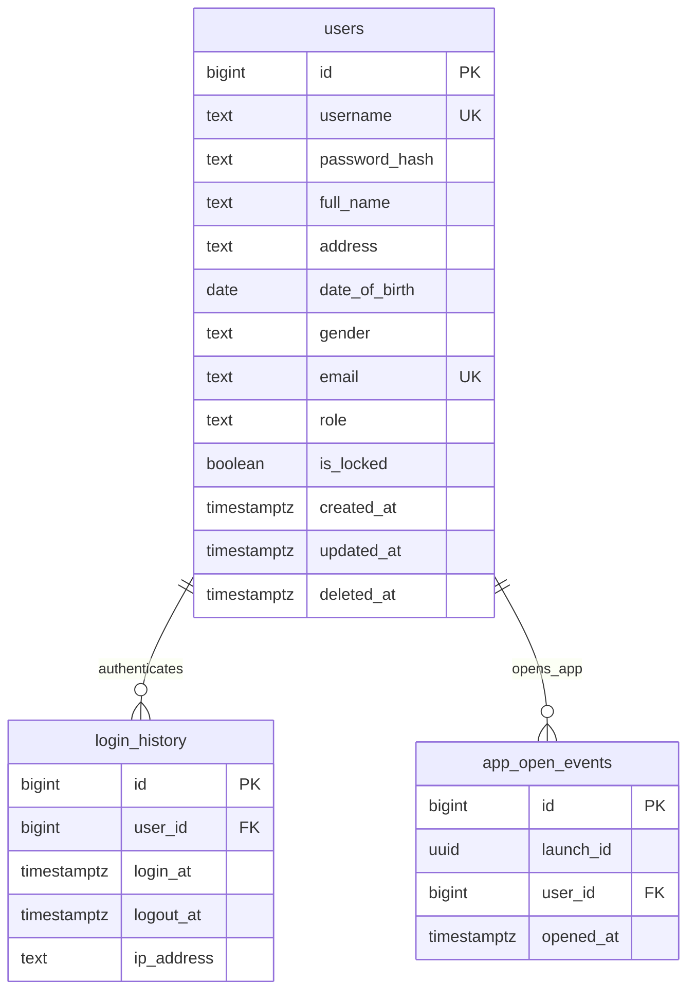
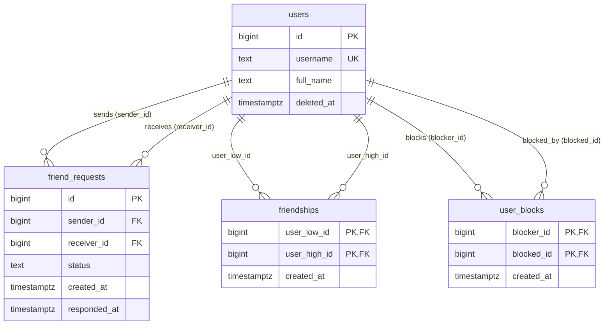
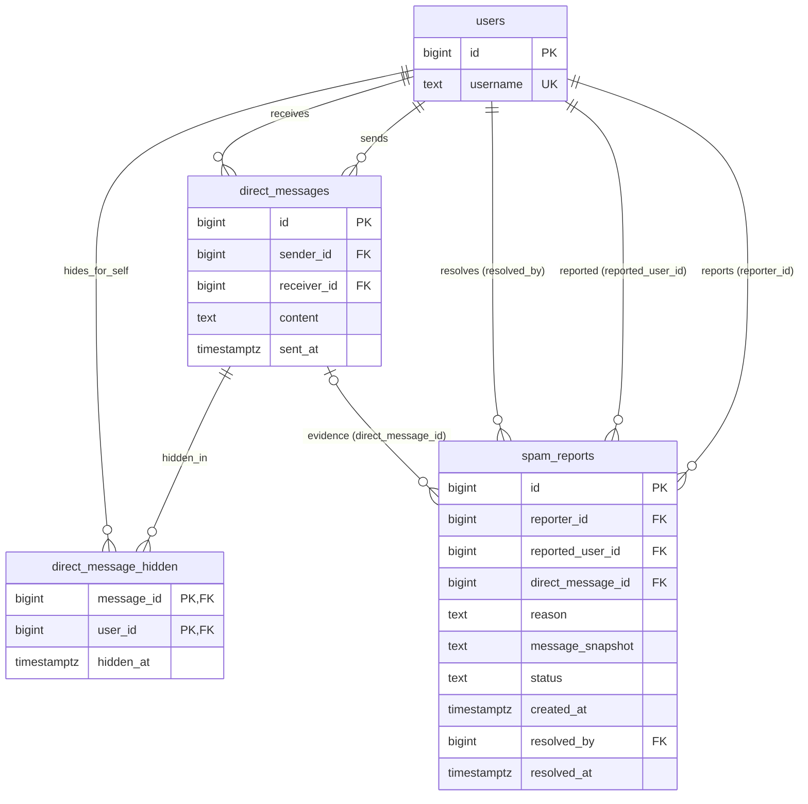
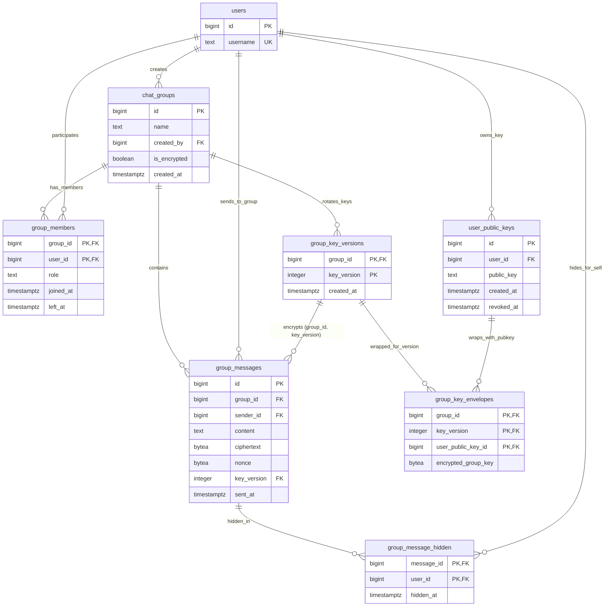

# Shared PostgreSQL Database Design Specification

**Final Course Project: Chat System (Version 1 — UI & Database Design)**  
**Database Engine:** PostgreSQL 15+ (Prepared for Spring Boot + `JdbcTemplate` + TCP Socket JSON in Version 2)  
**Database Design Owner:** Member 2 (Database Owner & Administrator Application Owner)

---

## 1. Architecture Overview & Standardized Business Rules

This database schema serves both the **User Application (Member 1)** and the **Administrator Application (Member 2)**. Where the course assignment specification leaves implementation details open, the following 10 standardized business rules govern both subsystems:

### Rule 1 — Direct Friends (`friendships`)
- Direct friendships are represented exclusively by rows in the `friendships` table.
- Each accepted friendship pair is stored as **one canonical row** in `friendships` enforcing `user_low_id < user_high_id`.
- The `friend_requests` table stores friend request workflows and statuses (`PENDING`, `ACCEPTED`, `REJECTED`, `CANCELLED`). When a `PENDING` request is accepted, the service layer executes an atomic transaction that updates `friend_requests.status = 'ACCEPTED'` and `responded_at = now()`, and inserts `(LEAST(sender_id, receiver_id), GREATEST(sender_id, receiver_id))` into `friendships`.

### Rule 2 — Friends Including Friends-of-Friends
- On the Admin Friend Statistics screen (PDF Item 7), the **"Friends Including Friends-of-Friends"** column for user $u$ is defined as:
  > The count of **`DISTINCT` active (`deleted_at IS NULL`) users** reachable from $u$ in **1 or 2 accepted friendship edges** in `friendships`, **excluding user $u$**.
- Pending (`PENDING`), rejected (`REJECTED`), or cancelled (`CANCELLED`) friend requests do **not** count.
- Soft-deleted accounts (`deleted_at IS NOT NULL`) are excluded both as direct friends and as intermediate nodes on 2-hop paths.

### Rule 3 — Directional Blocking (Team Convention)
- Blocks are directional and stored separately in `user_blocks(blocker_id, blocked_id, created_at)`.
- **Effects whenever a block exists in either direction between $A$ and $B$ (`(A, B)` or `(B, A)`):**
  1. Direct messaging (`direct_messages`) is prohibited in both directions.
  2. Sending new friend requests (`friend_requests`) is prohibited in both directions.
  3. Both users are hidden from each other's user search results in the User application.
  4. When $A$ blocks $B$, the service transaction removes any existing row between them in `friendships` and transitions any `PENDING` requests between them in `friend_requests` to `CANCELLED` (with `responded_at = now()`).
  5. **Shared group memberships (`group_members`) remain unchanged** (both users may continue participating in common chat groups).

### Rule 4 — Activity Filter Metric Selection
- On the Admin **User Activity Statistics** screen (PDF Item 8), filtering by activity count (`=`, `<`, or `>` against a user-entered number) requires selecting **one specific metric**:
  1. **App Opens** (`app_opens` — counted from `app_open_events`),
  2. **Distinct Direct-Message Recipients** (`distinct_direct_recipients` — `COUNT(DISTINCT receiver_id)` from `direct_messages`),
  3. **Distinct Groups Messaged** (`distinct_groups_messaged` — `COUNT(DISTINCT group_id)` from `group_messages`).
- An undefined aggregate "total activity" metric is **not** used.

### Rule 5 — Active User Definition & Annual Activity Chart
- **Active Users List in `[start, end)` (PDF Item 8):** A user is considered active in `[start, end)` if they have **at least one app-open event** (`app_open_events`) **OR** send **at least one direct message** (`direct_messages`) **OR** send **at least one group message** (`group_messages`) within `[start, end)`.
- **Annual Activity Chart (PDF Item 9):** For a selected year, the vertical axis for each month (Months 1..12) counts **`COUNT(DISTINCT user_id)`** having rows in `app_open_events` during that month.

### Rule 6 — App Opens (`app_open_events`) Counted Separately from Logins (`login_history`)
- `login_history` records successful authentication sessions (`login_at`, `logout_at`, `ip_address`) for Admin Items 1e and 2.
- `app_open_events` tracks application launches separately for Admin Items 8 and 9:
  - Each User-app desktop process launch generates one client-side `launch_id` (`UUID`).
  - Once a user authenticates during that process run, the server records at most **one** row per `(launch_id, user_id)` via `UNIQUE (launch_id, user_id)`.
  - Reconnecting or logging back in as the same user within the same process launch (`launch_id`) does **not** create an additional app-open event.
  - Unauthenticated application launches cannot be attributed to a `user_id` and are not recorded.

### Rule 7 — Deleting Messages / Chat History Hides Messages for That User Only
- When a user deletes single messages or clears a conversation history, the system inserts rows into `direct_message_hidden(message_id, user_id, hidden_at)` or `group_message_hidden(message_id, user_id, hidden_at)`.
- Underlying rows in `direct_messages` and `group_messages` are **not** deleted, other participants still see their history, and historical activity counts in the Admin application are not reduced.

### Rule 8 — Soft Account Deletion (`users.deleted_at`), Lock Status & Password Reset
- Deleting a user account sets `users.deleted_at = now()` (soft deletion) rather than executing a physical `DELETE`.
- **Historical counts and logs** (newly registered users, registration charts, login history, active user lists, and annual activity charts) retain soft-deleted accounts whose events occurred in the queried range.
- **Current friend lists and friend statistics** exclude soft-deleted accounts (`deleted_at IS NULL`) and exclude 2-hop friendship paths passing through soft-deleted accounts.
- **Locked accounts (`is_locked = TRUE`)** remain visible in lists and statistics unless explicitly filtered by account status.
- **Password reset / update:** Generating a random reset password (emailed to the user) or updating a password overwrites `users.password_hash`; no plaintext password column is stored.

### Rule 9 — Time-Range Filtering `[start, end)` & Time Zone
- All time-range queries use half-open intervals `[start, end)`:
  ```sql
  event_timestamp >= :start_inclusive AND event_timestamp < :end_exclusive
  ```
- All calendar dates, months (1..12), and years are evaluated in time zone **`Asia/Ho_Chi_Minh` (`UTC+07:00`)**.

### Rule 10 — Online Presence
- Real-time online/offline presence belongs to authenticated live TCP socket connections and heartbeats in the Version 2 Spring Boot server.
- `users.is_online` is **not** persisted in PostgreSQL as the source of truth.

---

## 2. Entity-Relationship Diagrams (Mermaid ER)

For readability, the 16 database tables are organized into **4 logical sections**:

### 2.1. Section 1 — Identity, Login History & App-Open Events



### 2.2. Section 2 — Social Graph: Friend Requests, Friendships & Blocks



### 2.3. Section 3 — Direct Messaging, Per-User Hiding & Spam Reports



### 2.4. Section 4 — Group Chat & Encryption Storage Preparation



---

## 3. Data Dictionary

### General Type & Vocabulary Conventions
- **Identity Primary Keys:** `BIGINT GENERATED BY DEFAULT AS IDENTITY` (supports explicit deterministic IDs in seed scripts while auto-incrementing in production).
- **Event Timestamps:** `TIMESTAMPTZ` (`TIMESTAMP WITH TIME ZONE`), defaulting to `now()`.
- **Birth Dates:** `DATE`.
- **Process Launch Identifier:** `UUID`.
- **Finite Statuses & Roles:** `TEXT` with `CHECK` constraints (avoiding rigid PostgreSQL `ENUM` types for straightforward compatibility with Spring `JdbcTemplate`).
- **Gender Vocabulary (`users.gender`):** Standardized uppercase English values `'MALE'`, `'FEMALE'`, `'OTHER'` in PostgreSQL (mapped 1-to-1 to Vietnamese Swing UI labels `'Nam'`, `'Nữ'`, `'Khác'`), maintaining consistency with all other enum tokens in the schema.

---

### 3.1. Table `users` (User & Administrator Accounts)
| Column | Type | Null? | Default | Constraints & Description |
|---|---|---|---|---|
| `id` | `BIGINT` | `NOT NULL` | `IDENTITY` | `PRIMARY KEY`. |
| `username` | `TEXT` | `NOT NULL` | — | Account username (`btrim(username) <> ''`), case-insensitively unique via `UNIQUE INDEX (LOWER(username))`. |
| `password_hash` | `TEXT` | `NOT NULL` | — | Password hash (BCrypt/Argon2). Password reset replaces this column; no plaintext password column exists. |
| `full_name` | `TEXT` | `NOT NULL` | — | Display full name (`btrim(full_name) <> ''`). |
| `address` | `TEXT` | `NULL` | `NULL` | Contact / residential address. |
| `date_of_birth` | `DATE` | `NULL` | `NULL` | Date of birth. |
| `gender` | `TEXT` | `NOT NULL` | `'OTHER'` | `CHECK (gender IN ('MALE', 'FEMALE', 'OTHER'))`. |
| `email` | `TEXT` | `NOT NULL` | — | Email address (`btrim(email) <> ''`), case-insensitively unique via `UNIQUE INDEX (LOWER(email))`. |
| `role` | `TEXT` | `NOT NULL` | `'USER'` | `CHECK (role IN ('USER', 'ADMIN'))`. |
| `is_locked` | `BOOLEAN` | `NOT NULL` | `FALSE` | `TRUE` if the account is locked by an administrator. |
| `created_at` | `TIMESTAMPTZ` | `NOT NULL` | `now()` | Account registration timestamp. |
| `updated_at` | `TIMESTAMPTZ` | `NOT NULL` | `now()` | Most recent profile update timestamp (`CHECK (updated_at >= created_at)`). Application-maintained on subsequent edits (`DEFAULT now()` applies only on `INSERT`). |
| `deleted_at` | `TIMESTAMPTZ` | `NULL` | `NULL` | Soft-deletion timestamp (`NULL` = active / not deleted; `CHECK (deleted_at IS NULL OR deleted_at >= created_at)`). |

- **Indexes on `users`:**
  - `uq_users_username_lower`: `UNIQUE (LOWER(username))`
  - `uq_users_email_lower`: `UNIQUE (LOWER(email))`
  - `idx_users_created_at`: `(created_at)` — supports creation-date sorting, newly registered user queries, and annual registration charts.
  - `idx_users_full_name`: `(full_name)` — supports name filtering and sorting.
  - `idx_users_active_not_deleted`: `(id) WHERE deleted_at IS NULL` — optimizes queries over non-deleted users.

---

### 3.2. Table `login_history` (Authentication Session Log)
| Column | Type | Null? | Default | Constraints & Description |
|---|---|---|---|---|
| `id` | `BIGINT` | `NOT NULL` | `IDENTITY` | `PRIMARY KEY`. |
| `user_id` | `BIGINT` | `NOT NULL` | — | `FOREIGN KEY REFERENCES users(id) ON DELETE RESTRICT`. |
| `login_at` | `TIMESTAMPTZ` | `NOT NULL` | `now()` | Successful login timestamp. |
| `logout_at` | `TIMESTAMPTZ` | `NULL` | `NULL` | Logout timestamp (`CHECK (logout_at IS NULL OR logout_at >= login_at)`). |
| `ip_address` | `TEXT` | `NULL` | `NULL` | Client IP address at login. |

- **Indexes on `login_history`:**
  - `idx_login_history_login_at_desc`: `(login_at DESC)` — supports system-wide chronological login history (PDF Item 2).
  - `idx_login_history_user_login_desc`: `(user_id, login_at DESC)` — supports per-user login history (PDF Item 1e).

---

### 3.3. Table `app_open_events` (Application Launch Events)
| Column | Type | Null? | Default | Constraints & Description |
|---|---|---|---|---|
| `id` | `BIGINT` | `NOT NULL` | `IDENTITY` | `PRIMARY KEY`. |
| `launch_id` | `UUID` | `NOT NULL` | — | Client UUID generated once per User-app process launch. |
| `user_id` | `BIGINT` | `NOT NULL` | — | `FOREIGN KEY REFERENCES users(id) ON DELETE RESTRICT`. |
| `opened_at` | `TIMESTAMPTZ` | `NOT NULL` | `now()` | Timestamp recorded when the authenticated session registers its process launch. |

- **Constraints & Indexes on `app_open_events`:**
  - `uq_app_open_events_launch_user`: `UNIQUE (launch_id, user_id)` — ensures reconnection or relogin within the same process launch does not record duplicate app-open events for the same user.
  - `idx_app_open_events_opened_at_user`: `(opened_at, user_id)` — supports time-range app-open counts (PDF Item 8) and monthly distinct active user counts (PDF Item 9).
  - `idx_app_open_events_user_opened_at`: `(user_id, opened_at)`.

---

### 3.4. Table `friend_requests` (Friend Request Workflow)
| Column | Type | Null? | Default | Constraints & Description |
|---|---|---|---|---|
| `id` | `BIGINT` | `NOT NULL` | `IDENTITY` | `PRIMARY KEY`. |
| `sender_id` | `BIGINT` | `NOT NULL` | — | `FOREIGN KEY REFERENCES users(id) ON DELETE RESTRICT`. |
| `receiver_id` | `BIGINT` | `NOT NULL` | — | `FOREIGN KEY REFERENCES users(id) ON DELETE RESTRICT`. |
| `status` | `TEXT` | `NOT NULL` | `'PENDING'` | `CHECK (status IN ('PENDING', 'ACCEPTED', 'REJECTED', 'CANCELLED'))`. |
| `created_at` | `TIMESTAMPTZ` | `NOT NULL` | `now()` | Request creation timestamp. |
| `responded_at` | `TIMESTAMPTZ` | `NULL` | `NULL` | Response or cancellation timestamp (`CHECK ((status = 'PENDING' AND responded_at IS NULL) OR (status <> 'PENDING' AND responded_at IS NOT NULL AND responded_at >= created_at))`). |

- **Constraints & Indexes on `friend_requests`:**
  - `chk_friend_requests_no_self`: `CHECK (sender_id <> receiver_id)`.
  - `uq_friend_requests_pending_pair`: Partial Unique Expression Index `UNIQUE (LEAST(sender_id, receiver_id), GREATEST(sender_id, receiver_id)) WHERE status = 'PENDING'` — enforces at most one `PENDING` request per unordered user pair.
  - `idx_friend_requests_receiver_status`: `(receiver_id, status, created_at DESC)`.
  - `idx_friend_requests_sender_status`: `(sender_id, status, created_at DESC)`.

---

### 3.5. Table `friendships` (Accepted Direct Friendships)
| Column | Type | Null? | Default | Constraints & Description |
|---|---|---|---|---|
| `user_low_id` | `BIGINT` | `NOT NULL` | — | Smaller user ID (`FOREIGN KEY REFERENCES users(id) ON DELETE RESTRICT`). |
| `user_high_id` | `BIGINT` | `NOT NULL` | — | Larger user ID (`FOREIGN KEY REFERENCES users(id) ON DELETE RESTRICT`). |
| `created_at` | `TIMESTAMPTZ` | `NOT NULL` | `now()` | Friendship establishment timestamp. |

- **Constraints & Indexes on `friendships`:**
  - `PRIMARY KEY (user_low_id, user_high_id)`.
  - `chk_friendships_canonical_order`: `CHECK (user_low_id < user_high_id)` — prevents self-friendship and guarantees a single canonical row per friendship pair.
  - `idx_friendships_high_low`: `(user_high_id, user_low_id)` — enables bidirectional index-only scans for 1-hop and 2-hop friend queries (PDF Items 1f & 7).

---

### 3.6. Table `user_blocks` (Directional User Blocks)
| Column | Type | Null? | Default | Constraints & Description |
|---|---|---|---|---|
| `blocker_id` | `BIGINT` | `NOT NULL` | — | User initiating the block (`FOREIGN KEY REFERENCES users(id) ON DELETE RESTRICT`). |
| `blocked_id` | `BIGINT` | `NOT NULL` | — | Blocked user (`FOREIGN KEY REFERENCES users(id) ON DELETE RESTRICT`). |
| `created_at` | `TIMESTAMPTZ` | `NOT NULL` | `now()` | Block timestamp. |

- **Constraints & Indexes on `user_blocks`:**
  - `PRIMARY KEY (blocker_id, blocked_id)`.
  - `chk_user_blocks_no_self`: `CHECK (blocker_id <> blocked_id)`.
  - `idx_user_blocks_blocked_blocker`: `(blocked_id, blocker_id)` — supports fast bidirectional block checks.

---

### 3.7. Table `direct_messages` (1-to-1 Direct Messages)
| Column | Type | Null? | Default | Constraints & Description |
|---|---|---|---|---|
| `id` | `BIGINT` | `NOT NULL` | `IDENTITY` | `PRIMARY KEY`. |
| `sender_id` | `BIGINT` | `NOT NULL` | — | Message sender (`FOREIGN KEY REFERENCES users(id) ON DELETE RESTRICT`). |
| `receiver_id` | `BIGINT` | `NOT NULL` | — | Message recipient (`FOREIGN KEY REFERENCES users(id) ON DELETE RESTRICT`). |
| `content` | `TEXT` | `NOT NULL` | — | Message body (`CHECK (btrim(content) <> '')`). |
| `sent_at` | `TIMESTAMPTZ` | `NOT NULL` | `now()` | Message send timestamp. |

- **Constraints & Indexes on `direct_messages`:**
  - `chk_direct_messages_no_self`: `CHECK (sender_id <> receiver_id)`.
  - `idx_direct_messages_conversation_time`: `(LEAST(sender_id, receiver_id), GREATEST(sender_id, receiver_id), sent_at DESC)` — supports conversation history retrieval.
  - `idx_direct_messages_sender_sent_at`: `(sender_id, sent_at, receiver_id)` — supports counting `DISTINCT receiver_id` per sender in `[start, end)` (PDF Item 8).

---

### 3.8. Table `direct_message_hidden` (Per-User Hidden Direct Messages)
| Column | Type | Null? | Default | Constraints & Description |
|---|---|---|---|---|
| `message_id` | `BIGINT` | `NOT NULL` | — | `FOREIGN KEY REFERENCES direct_messages(id) ON DELETE RESTRICT`. |
| `user_id` | `BIGINT` | `NOT NULL` | — | User who hid the message (`FOREIGN KEY REFERENCES users(id) ON DELETE RESTRICT`). |
| `hidden_at` | `TIMESTAMPTZ` | `NOT NULL` | `now()` | Timestamp when the message was hidden for `user_id`. |

- **Constraints & Indexes on `direct_message_hidden`:**
  - `PRIMARY KEY (message_id, user_id)`.
  - `idx_direct_message_hidden_user_msg`: `(user_id, message_id)`.

---

### 3.9. Table `chat_groups` (Chat Groups)
| Column | Type | Null? | Default | Constraints & Description |
|---|---|---|---|---|
| `id` | `BIGINT` | `NOT NULL` | `IDENTITY` | `PRIMARY KEY`. |
| `name` | `TEXT` | `NOT NULL` | — | Group display name (`CHECK (btrim(name) <> '')`). |
| `created_by` | `BIGINT` | `NOT NULL` | — | Group creator (`FOREIGN KEY REFERENCES users(id) ON DELETE RESTRICT`). |
| `is_encrypted` | `BOOLEAN` | `NOT NULL` | `FALSE` | `TRUE` if group encryption is enabled. |
| `created_at` | `TIMESTAMPTZ` | `NOT NULL` | `now()` | Group creation timestamp. |

- **Indexes on `chat_groups`:**
  - `idx_chat_groups_name`: `(name)` — supports group name filtering and sorting (PDF Item 3a, 3b).
  - `idx_chat_groups_created_at`: `(created_at DESC)` — supports creation-time sorting (PDF Item 3a).
  - `idx_chat_groups_created_by`: `(created_by)`.

---

### 3.10. Table `group_members` (Group Members & Administrators)
| Column | Type | Null? | Default | Constraints & Description |
|---|---|---|---|---|
| `group_id` | `BIGINT` | `NOT NULL` | — | `FOREIGN KEY REFERENCES chat_groups(id) ON DELETE RESTRICT`. |
| `user_id` | `BIGINT` | `NOT NULL` | — | `FOREIGN KEY REFERENCES users(id) ON DELETE RESTRICT`. |
| `role` | `TEXT` | `NOT NULL` | `'MEMBER'` | `CHECK (role IN ('MEMBER', 'ADMIN'))`. |
| `joined_at` | `TIMESTAMPTZ` | `NOT NULL` | `now()` | Latest join timestamp. |
| `left_at` | `TIMESTAMPTZ` | `NULL` | `NULL` | `NULL` while active; non-null when the user left or was removed (`CHECK (left_at IS NULL OR left_at >= joined_at)`). |

- **Constraints, Indexes & Documented Limitation on `group_members`:**
  - `PRIMARY KEY (group_id, user_id)`.
  - `idx_group_members_active_group_role`: `(group_id, role) WHERE left_at IS NULL` — supports listing active members (PDF Item 3c) and active group admins (PDF Item 3d).
  - `idx_group_members_active_user`: `(user_id, group_id) WHERE left_at IS NULL`.
  - **Documented Limitation:** Because `(group_id, user_id)` is the primary key, each row represents the **current or latest membership state** for a user in a group rather than a multi-interval membership history timeline. Re-adding a former member (`left_at IS NOT NULL`) updates the existing row (`joined_at = now()`, `left_at = NULL`, `role = 'MEMBER'`).

---

### 3.11. Table `group_messages` (Group Chat Messages)
| Column | Type | Null? | Default | Constraints & Description |
|---|---|---|---|---|
| `id` | `BIGINT` | `NOT NULL` | `IDENTITY` | `PRIMARY KEY`. |
| `group_id` | `BIGINT` | `NOT NULL` | — | `FOREIGN KEY REFERENCES chat_groups(id) ON DELETE RESTRICT`. |
| `sender_id` | `BIGINT` | `NOT NULL` | — | `FOREIGN KEY REFERENCES users(id) ON DELETE RESTRICT`. |
| `content` | `TEXT` | `NULL` | `NULL` | Plaintext message body (populated only for unencrypted messages). |
| `ciphertext` | `BYTEA` | `NULL` | `NULL` | Encrypted message payload (populated only for encrypted messages). |
| `nonce` | `BYTEA` | `NULL` | `NULL` | Initialization vector / nonce accompanying `ciphertext`. |
| `key_version` | `INTEGER` | `NULL` | `NULL` | Group key version used to encrypt this message. |
| `sent_at` | `TIMESTAMPTZ` | `NOT NULL` | `now()` | Message send timestamp. |

- **Constraints & Indexes on `group_messages`:**
  - **Per-message plaintext vs. ciphertext distinction (`chk_group_messages_payload_mode`):**
    ```sql
    CHECK (
        (
            content IS NOT NULL
            AND COALESCE(btrim(content), '') <> ''
            AND ciphertext IS NULL
            AND nonce IS NULL
            AND key_version IS NULL
        )
        OR
        (
            content IS NULL
            AND ciphertext IS NOT NULL
            AND COALESCE(octet_length(ciphertext), 0) > 0
            AND nonce IS NOT NULL
            AND COALESCE(octet_length(nonce), 0) > 0
            AND key_version IS NOT NULL
        )
    )
    ```
  - **Same-group key version foreign key (`fk_group_messages_key_version`):**
    `FOREIGN KEY (group_id, key_version) REFERENCES group_key_versions(group_id, key_version) ON DELETE RESTRICT` (Under standard PostgreSQL `MATCH SIMPLE` semantics, unencrypted rows with `key_version IS NULL` are allowed, whereas encrypted rows with `key_version IS NOT NULL` must match a `(group_id, key_version)` row belonging to the same `group_id`, without requiring any cross-table `CHECK`).
  - `idx_group_messages_group_sent_at`: `(group_id, sent_at DESC)`.
  - `idx_group_messages_sender_sent_at`: `(sender_id, sent_at, group_id)` — supports counting `DISTINCT group_id` messaged by `sender_id` in `[start, end)` (PDF Item 8).
  - `idx_group_messages_group_key_version`: `(group_id, key_version) WHERE key_version IS NOT NULL`.

---

### 3.12. Table `group_message_hidden` (Per-User Hidden Group Messages)
| Column | Type | Null? | Default | Constraints & Description |
|---|---|---|---|---|
| `message_id` | `BIGINT` | `NOT NULL` | — | `FOREIGN KEY REFERENCES group_messages(id) ON DELETE RESTRICT`. |
| `user_id` | `BIGINT` | `NOT NULL` | — | `FOREIGN KEY REFERENCES users(id) ON DELETE RESTRICT`. |
| `hidden_at` | `TIMESTAMPTZ` | `NOT NULL` | `now()` | Timestamp when the group message was hidden for `user_id`. |

- **Constraints & Indexes on `group_message_hidden`:**
  - `PRIMARY KEY (message_id, user_id)`.
  - `idx_group_message_hidden_user_msg`: `(user_id, message_id)`.

---

### 3.13. Table `spam_reports` (Spam Reports)
| Column | Type | Null? | Default | Constraints & Description |
|---|---|---|---|---|
| `id` | `BIGINT` | `NOT NULL` | `IDENTITY` | `PRIMARY KEY`. |
| `reporter_id` | `BIGINT` | `NOT NULL` | — | Reporting user (`FOREIGN KEY REFERENCES users(id) ON DELETE RESTRICT`). |
| `reported_user_id` | `BIGINT` | `NOT NULL` | — | Reported user (`FOREIGN KEY REFERENCES users(id) ON DELETE RESTRICT`). |
| `direct_message_id` | `BIGINT` | `NULL` | `NULL` | Optional referenced direct message (`FOREIGN KEY REFERENCES direct_messages(id) ON DELETE RESTRICT`). |
| `reason` | `TEXT` | `NOT NULL` | — | Report reason (`CHECK (btrim(reason) <> '')`). |
| `message_snapshot` | `TEXT` | `NULL` | `NULL` | Snapshot of the reported message content at report time. |
| `status` | `TEXT` | `NOT NULL` | `'PENDING'` | `CHECK (status IN ('PENDING', 'RESOLVED'))`. |
| `created_at` | `TIMESTAMPTZ` | `NOT NULL` | `now()` | Report creation timestamp. |
| `resolved_by` | `BIGINT` | `NULL` | `NULL` | Administrator who resolved the report (`FOREIGN KEY REFERENCES users(id) ON DELETE RESTRICT`). |
| `resolved_at` | `TIMESTAMPTZ` | `NULL` | `NULL` | Resolution timestamp (`CHECK ((status = 'PENDING' AND resolved_by IS NULL AND resolved_at IS NULL) OR (status = 'RESOLVED' AND resolved_by IS NOT NULL AND resolved_at IS NOT NULL AND resolved_at >= created_at))`). |

- **Constraints & Indexes on `spam_reports`:**
  - `chk_spam_reports_no_self`: `CHECK (reporter_id <> reported_user_id)`.
  - `idx_spam_reports_created_at_desc`: `(created_at DESC)` — supports sorting and filtering by report timestamp (PDF Item 4a, 4b).
  - `idx_spam_reports_reported_user`: `(reported_user_id, created_at DESC)` — supports filtering and sorting by reported username (PDF Item 4a, 4c).
  - `idx_spam_reports_reporter_user`: `(reporter_id, created_at DESC)`.

---

### 3.14. Encryption Storage Preparation Tables

> **Scope & Security Boundaries:**
> - These three tables provide **storage preparation** for user public keys, per-group key versions, and per-member wrapped group key envelopes.
> - **Private keys and plaintext symmetric group keys are never stored** in the database.
> - Encrypted group messages (`group_messages.key_version IS NOT NULL`, stored in `ciphertext`) **cannot** be searched using server-side plaintext SQL (`ILIKE`); searching encrypted messages requires client-side decryption.

#### Table 14: `user_public_keys` (User Public Keys)
| Column | Type | Null? | Default | Constraints & Description |
|---|---|---|---|---|
| `id` | `BIGINT` | `NOT NULL` | `IDENTITY` | `PRIMARY KEY`. |
| `user_id` | `BIGINT` | `NOT NULL` | — | `FOREIGN KEY REFERENCES users(id) ON DELETE RESTRICT`. |
| `public_key` | `TEXT` | `NOT NULL` | — | Encoded public key material (`CHECK (btrim(public_key) <> '')`). |
| `created_at` | `TIMESTAMPTZ` | `NOT NULL` | `now()` | Public key registration timestamp. |
| `revoked_at` | `TIMESTAMPTZ` | `NULL` | `NULL` | Revocation timestamp (`CHECK (revoked_at IS NULL OR revoked_at >= created_at)`). |

- **Indexes on `user_public_keys`:**
  - `idx_user_public_keys_active_user`: `(user_id, created_at DESC) WHERE revoked_at IS NULL`.

#### Table 15: `group_key_versions` (Group Symmetric Key Versions)
| Column | Type | Null? | Default | Constraints & Description |
|---|---|---|---|---|
| `group_id` | `BIGINT` | `NOT NULL` | — | `FOREIGN KEY REFERENCES chat_groups(id) ON DELETE RESTRICT`. |
| `key_version` | `INTEGER` | `NOT NULL` | — | Monotonically increasing version number (`CHECK (key_version >= 1)`). |
| `created_at` | `TIMESTAMPTZ` | `NOT NULL` | `now()` | Key version creation timestamp. |

- **Constraints on `group_key_versions`:**
  - `PRIMARY KEY (group_id, key_version)`.

#### Table 16: `group_key_envelopes` (Wrapped Group Key Envelopes per Member Public Key)
| Column | Type | Null? | Default | Constraints & Description |
|---|---|---|---|---|
| `group_id` | `BIGINT` | `NOT NULL` | — | Chat group ID. |
| `key_version` | `INTEGER` | `NOT NULL` | — | Group key version. |
| `user_public_key_id` | `BIGINT` | `NOT NULL` | — | `FOREIGN KEY REFERENCES user_public_keys(id) ON DELETE RESTRICT`. |
| `encrypted_group_key` | `BYTEA` | `NOT NULL` | — | Group symmetric key encrypted (wrapped) under `user_public_key_id` (`CHECK (COALESCE(octet_length(encrypted_group_key), 0) > 0)`). |

- **Constraints & Indexes on `group_key_envelopes`:**
  - `PRIMARY KEY (group_id, key_version, user_public_key_id)`.
  - `fk_group_key_envelopes_version`: `FOREIGN KEY (group_id, key_version) REFERENCES group_key_versions(group_id, key_version) ON DELETE RESTRICT`.
  - `idx_group_key_envelopes_pubkey`: `(user_public_key_id, group_id, key_version)`.

---

## 4. SQL-Enforceable Constraints vs. Future Service-Layer Transactional Checks

Cross-table `CHECK` expressions are avoided. Integrity rules are cleanly divided between declarative PostgreSQL constraints and transactional checks in the future Version 2 Spring Boot service layer:

### 4.1. Invariants Enforced Directly by PostgreSQL
1. **Case-insensitive uniqueness:** Unique expression indexes on `LOWER(username)` and `LOWER(email)` in `users`.
2. **Canonical friendship ordering:** `PRIMARY KEY (user_low_id, user_high_id)` and `CHECK (user_low_id < user_high_id)` in `friendships`.
3. **At most one pending friend request per unordered user pair:** Partial unique index on `(LEAST(sender_id, receiver_id), GREATEST(sender_id, receiver_id)) WHERE status = 'PENDING'` in `friend_requests`.
4. **No self-relationships:** `sender_id <> receiver_id` (`friend_requests`, `direct_messages`), `blocker_id <> blocked_id` (`user_blocks`), `reporter_id <> reported_user_id` (`spam_reports`), and `user_low_id < user_high_id` (`friendships`).
5. **At most one app-open event per launch and user:** `UNIQUE (launch_id, user_id)` in `app_open_events`.
6. **Per-message plaintext/ciphertext validity & same-group key reference:** Single-table `CHECK` on `group_messages` combined with composite foreign key `(group_id, key_version) REFERENCES group_key_versions(group_id, key_version)`.
7. **Finite status & role vocabularies:** Single-table `CHECK (... IN (...))` constraints on `users.role`, `users.gender`, `friend_requests.status`, `group_members.role`, and `spam_reports.status`.

### 4.2. Transactional Rules Enforced by the Version 2 Service Layer
1. **Authorization & Account State Checks:**
   - Only authenticated accounts with `users.role = 'ADMIN'`, `is_locked = FALSE`, and `deleted_at IS NULL` may invoke administrative operations (user CRUD, lock/unlock, password reset, spam resolution, and system statistics).
   - Accounts with `is_locked = TRUE` or `deleted_at IS NOT NULL` are rejected at login and disconnected from active TCP sessions.
2. **Block Checks:**
   - Before allowing user $A$ to send a direct message to $B$, send a friend request to $B$, or see $B$ in user search results, verify that no row exists in `user_blocks` matching `(blocker_id = A AND blocked_id = B) OR (blocker_id = B AND blocked_id = A)`.
   - When $A$ blocks $B$: within a single transaction, insert `(A, B)` into `user_blocks`, delete `(LEAST(A, B), GREATEST(A, B))` from `friendships` (if present), and update any `PENDING` rows between $A$ and $B$ in `friend_requests` to `status = 'CANCELLED', responded_at = now()`.
3. **Friendship Acceptance:**
   - Before creating a `PENDING` request between $A$ and $B$, verify neither user is soft-deleted, blocked by the other, or already friends in `friendships`.
   - When receiver $B$ accepts a `PENDING` request from $A$: within a single transaction, re-verify no block or soft deletion exists, update the `friend_requests` row to `status = 'ACCEPTED', responded_at = now()`, and insert `(LEAST(A, B), GREATEST(A, B))` into `friendships`.
4. **Active Group Membership:**
   - Only active members of a group (`EXISTS` in `group_members` with `group_id = :g AND user_id = :u AND left_at IS NULL` and `users.deleted_at IS NULL`) may send `group_messages`, read group history, rename the group, or add members.
   - Creating a group (`chat_groups`) requires specifying at least one additional initial member alongside `created_by` (PDF Page 3, Item 12a) and inserts `created_by` into `group_members` with `role = 'ADMIN'`.
   - Only active group admins (`role = 'ADMIN' AND left_at IS NULL`) may promote another member to `ADMIN` or remove a member (`left_at = now()`).
5. **Maintaining at Least One Group Admin:**
   - Before an active group `ADMIN` leaves a group, is demoted to `MEMBER`, or has their account soft-deleted, the service layer ensures at least one other active member holds `role = 'ADMIN' AND left_at IS NULL` (or promotes the longest-tenured active member in the same transaction).
6. **Message-Hiding Permissions:**
   - Inserting into `direct_message_hidden(message_id, user_id)` requires verifying that `user_id` is either `sender_id` or `receiver_id` of `direct_messages.id = message_id`.
   - Inserting into `group_message_hidden(message_id, user_id)` requires verifying that `group_messages.id = message_id` belongs to a `group_id` in which `user_id` has a membership record in `group_members`.
7. **Spam Report & Message Participant Consistency:**
   - When `reporter_id` submits a spam report against `reported_user_id` referencing `direct_message_id`, the service layer verifies that `direct_messages.id = direct_message_id` has `sender_id = reported_user_id` and `receiver_id = reporter_id`, and copies the message text into `spam_reports.message_snapshot`.
   - When an administrator locks the reported account from a spam report, the transaction sets `users.is_locked = TRUE` on `reported_user_id` and updates `spam_reports` to `status = 'RESOLVED', resolved_by = :admin_id, resolved_at = now()`.
8. **Group Key Rotation & Distribution:**
   - For unencrypted groups (`chat_groups.is_encrypted = FALSE`), the service layer rejects messages with `key_version IS NOT NULL`.
   - For encrypted groups (`chat_groups.is_encrypted = TRUE`), the service layer requires `key_version IS NOT NULL`, `ciphertext IS NOT NULL`, `nonce IS NOT NULL`, and `content IS NULL`.
   - When group encryption is enabled or group membership changes, a new `group_key_versions(group_id, key_version)` row is created and `group_key_envelopes` rows are stored for the active public keys (`user_public_keys.revoked_at IS NULL`) of all active group members (`group_members.left_at IS NULL`).
